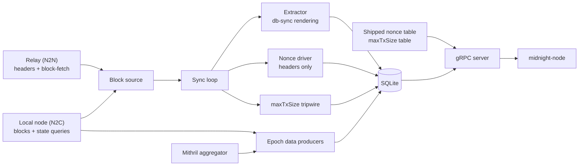

# mc-follower

mc-follower is a Cardano indexer for Midnight. It follows Cardano, indexes
only the data a Midnight node reads, and serves it to the node over gRPC, in
place of cardano-db-sync and PostgreSQL. The design is in
[docs/SPEC.md](docs/SPEC.md), the node interface in
[docs/CONTRACT.md](docs/CONTRACT.md) and [proto/mc_follower.proto](proto/mc_follower.proto).

It is written in Haskell on the Cardano node's own libraries
(ouroboros-network, cardano-diffusion, ouroboros-consensus, cardano-ledger,
cardano-api) and follows the chain in one of two modes:

- **node-to-node (N2N)** from one or more relays, with no local node: header
  chain-sync plus range block-fetch. The relay is trusted; headers are not
  validated. Stake distributions come from a Mithril aggregator,
  `maxTxSize` from a per-network table guarded by a tripwire.
- **node-to-client (N2C)** from a local cardano-node socket: chain-sync of
  full blocks, plus local state queries for stake distributions,
  `maxTxSize` and the node's protocol state.



Every block goes through the extractor, the tripwire and the nonce driver in
one SQLite transaction; a rollback undoes all three in one transaction. The
producers run next to the sync loop and fill in what no block carries.

## Building

The package set is pinned to the one cardano-node 11.2.3 uses (same Hackage
and CHaP index states, constraints and flags; see `cabal.project`).

Requirements:

- GHC 9.6 and cabal 3.10 or later
- `libsodium`, `libsecp256k1` and `libblst`, all visible to `pkg-config`
- `libsnappy` (for grapesy's compression support), visible to the C linker

On macOS, libsodium and secp256k1 come from Homebrew
(`brew install libsodium secp256k1 pkg-config`). blst is not packaged by
Homebrew; build it from [supranational/blst](https://github.com/supranational/blst)
and install a `libblst.pc` for it, then point `PKG_CONFIG_PATH` at that
directory. The project builds cardano-crypto-praos with
`-external-libsodium-vrf`, so stock libsodium is enough; IOG's libsodium fork
is not needed. Homebrew's snappy (`brew install snappy`) has no pkg-config
file and is not on the default linker path; tell cabal where it is in
`cabal.project.local` (not committed):

```cabal
package snappy-c
  extra-lib-dirs: /opt/homebrew/lib
  extra-include-dirs: /opt/homebrew/include
```

```sh
export PKG_CONFIG_PATH=$HOME/.local/blst/lib/pkgconfig   # where libblst.pc is
cabal update
cabal build all
$(cabal list-bin mc-follower-test)                      # unit and integration tests, offline
```

The first build compiles the whole Cardano dependency tree and takes a while.

The Haskell code for the proto messages is generated ahead of time and
committed under `gen/`, as cardano-rpc does, so building needs neither
`protoc` nor proto-lens-protoc. After changing the proto, regenerate it with
`scripts/gen-proto.sh` (it needs `protoc` and proto-lens-protoc 0.9.0.1, the
version that goes with the package set's proto-lens-runtime).

## Commands

| Command | What it does |
|---|---|
| `mc-follower serve` | Follow the chain into the database and serve it over gRPC in one process (or only serve, `--no-sync`) |
| `mc-follower sync` | Follow the chain into the database without serving (for a separate `serve --no-sync`, or bounded runs) |
| `mc-follower follow` | Smoke tool: follow the chain and print one line per event |
| `mc-follower fetch-blocks` | Fixture tool: print what blocks contain, optionally save them |
| `mc-follower system-start` | Smoke tool: a local state query against a node socket |
| `ledger-snapshot-praos-state` | Development tool (`dev/`): the trusted state in a node's ledger snapshot |

### Following the chain: `sync` and `serve`

```sh
mc-follower sync  --network NAME UPSTREAM --db PATH [--from origin|SLOT.HASH] [--blocks N] [EPOCH DATA OPTIONS]
mc-follower serve --network NAME (UPSTREAM | --no-sync) --db PATH [--listen HOST:PORT] [--from ...] [EPOCH DATA OPTIONS]
```

- `UPSTREAM` is `--relay HOST:PORT` (repeatable; N2N) or `--socket PATH`
  (N2C). With neither, the network's bootstrap relays are used (N2N).
  When a connection fails (cannot connect, protocol error, the relay knows
  none of the indexer's points) the next relay is tried after 5 s; once
  every relay has failed in a row the wait doubles per round, up to 5
  minutes. The indexer stops only when every relay in turn knows none of
  its points.
- `--db`: the database file; created if missing. A database is bound to the
  network and the watch set it was created with and refuses to open with
  others, or with another schema version (the current one is 2; a database
  of an older version is refused, never migrated: start a new one).
- `--from`: where a new database starts; the first block indexed is the one
  after this point. The default is the network's preset start point
  (`McFollower.WatchSet.startPointPreset`), which precedes every watched
  address and policy. Preview has one; mainnet and preprod have none yet, so
  `--from` is required there. When resuming, the stored start point is used
  and a different `--from` is refused.
- `--blocks N` (`sync` only): stop after applying N blocks.
- `--listen` (`serve` only): default `127.0.0.1:50051`, plain HTTP/2 without
  TLS. A Midnight node connects to `http://HOST:PORT`.
- `--no-sync` (`serve` only): serve an existing database that a separate
  `sync` keeps up to date. A database of another network or watch set is
  refused at startup; a missing one is answered with `UNAVAILABLE` until it
  exists.

Epoch data options (both commands; see the next section):

| Option | Meaning |
|---|---|
| `--trusted-state FILE` | Trusted Praos state for the nonce driver (JSON) |
| `--max-tx-size EPOCH:BYTES` | Add an entry to the network's `maxTxSize` table (repeatable) |
| `--acknowledge-proposal REF` | A reviewed proposal that changes `maxTxSize`; it no longer gates serving (repeatable) |
| `--mithril` / `--no-mithril` | Fetch stake distributions from Mithril; default on with relays, off with `--socket` |
| `--mithril-aggregator URL` | Default: the network's release aggregator (`McFollower.EpochData.Mithril.aggregatorFor`) |
| `--stake-backfill-epochs N` | Keep stake for the N epochs before the tip epoch, and the next one (default 6) |

With `serve --no-sync` only `--max-tx-size` and `--acknowledge-proposal`
matter (they shape answers); the others belong to the process that syncs.

Restarting resumes from the stored chain: the tip, then blocks 1, 2, 4, 8,
... below it, then the start point. Rollbacks reported by the upstream undo
the affected blocks in one transaction; rollbacks deeper than the security
parameter k are refused. Progress is written to stderr every 10 seconds,
together with the nonce driver's and the producers' events:

```text
serving gRPC on 127.0.0.1:50071
nonce driver: following, at 128252153.2b110a16…
intersected at 128252153.2b110a16…, upstream tip 128550158/4876963/9aab33d5…
epoch nonce of epoch 1485 produced at 128304002.a7907481…
epoch nonce of epoch 1486 produced at 128390462.3a64ad64…
synced to slot 128416390 block 4871726 epoch 1486, upstream block 4876963; 6202 blocks, 9079 txs, 10 watched outputs in 10s
epoch nonce of epoch 1487 produced at 128476806.2844d7d5…
epoch data: stake of epoch 1487 from Mithril (656 pools)
```

What is indexed (`McFollower.WatchSet`): every block (hash, number, slot,
epoch, time, transaction count) and transaction (hash, position); every
output at a watched address (mapping validator, council, technical
committee, committee candidates, bridge ICS and reserve) with all its assets;
every output carrying a token of a watched policy (cNIGHT, council, technical
committee, permissioned candidates, bridge token) at any address; spends of
those outputs; the input lists of transactions creating committee-candidate
outputs; every datum db-sync would put in its `datum` table (witness datums of
valid transactions and inline datums of all outputs); tx metadata under the
bridge label 6500973; and the epoch data below.

## Epoch data

### Epoch nonces

`GetEpochNonce` combines two sources (`McFollower.EpochNonceTable`):

- **The shipped table** `data/epoch-nonces/NETWORK.csv`: db-sync
  `epoch_param.nonce` of every past epoch, read from Koios (source and
  retrieval date in each file). Past nonces are fixed public values, so they
  are not recomputed. Regenerate or extend the files with
  `scripts/fetch-epoch-nonces.py NETWORK CACHE_DIR > data/epoch-nonces/NETWORK.csv`.
- **The nonce driver** (`McFollower.Nonce`) for epochs after the table: it
  runs the consensus library's own Praos transitions (`tickChainDepState`,
  `reupdateChainDepState`) over every header, from a trusted protocol state.
  Where the table also has an epoch the driver produces, the two must agree;
  a disagreement stops the sync at that block (nothing of the block is
  stored).

The driver supports Praos eras only (Babbage onward). Its trusted starting
state is given as JSON:

```json
{ "point": "SLOT.HASH", "praos_state_cbor": "<hex of the node's PraosState encoding>" }
```

The CBOR is what a node returns for `DebugChainDepState` in a Praos era
(`cardano-cli query protocol-state --out-file`). `ledger-snapshot-praos-state`
prints the state found in a node's ledger snapshot, e.g. from a Mithril
ancillary archive (`cabal run ledger-snapshot-praos-state -- preview ledger/128252153/state`);
`test/data/preview-trusted-128252153.json` was made that way.

Where the driver starts from (`McFollower.EpochData.Driver`):

1. Checkpoints stored by an earlier run: the driver resumes exactly where
   it stopped (it keeps its state after each of the last k + 1 blocks, in
   the same transaction as the block). `--trusted-state` is then not used.
2. N2C: the local node's protocol state at the stored tip, if the node
   still has that point in its volatile window.
3. `--trusted-state FILE`.
4. Nothing: the driver is off. The indexer runs and serves chain data as
   usual; nonces come from the shipped table only and later epochs are
   answered `UNAVAILABLE`.

The trusted state's point decides when the driver runs. Chain indexing
starts at the watch set's start point, usually long before any point a
trusted state is available for:

- at the stored tip: the driver starts at once;
- after the tip: the driver waits, and starts when the sync applies the
  block at that point (in that block's transaction). If the sync reaches a
  later slot without passing the point, the point is not on the followed
  chain: the sync stops with an error;
- at or before the tip: refused at startup, because the sync has already
  passed it and the headers since are not kept (or the point is not on the
  indexed chain, or before the start point). Use a later trusted state, or
  a new database whose start point precedes it.

A rollback to before the driver's starting point makes it wait for that
point again.

### Stake distributions

`GetStakeDistribution` for epoch N is db-sync's per-pool sum of
`epoch_stake` for N: the distribution the leader schedule of N is drawn from
(`McFollower.EpochData.Stake`). It is served only when stored complete.

- N2C: at startup, at each new epoch and every 10 minutes, the producer
  queries the node at its immutable tip: the go, set and mark snapshots are
  the distributions of epochs e - 1, e and e + 1.
- Mithril (default in N2N, `--mithril` in N2C to reach epochs outside the
  node's three): the distributions of the epochs from the upstream tip epoch
  minus `--stake-backfill-epochs` to the tip epoch plus one that are not
  stored yet. Mithril label L is the distribution for epoch L + 2. The
  artifact's certificate is fetched and must name the artifact and label;
  the multi-signature is not verified (the aggregator is trusted, as the
  relay is).

### `maxTxSize`

`GetMaxTxSize` answers for the epoch of the requested block:

- a local node's value for that epoch, if the producer stored one (N2C);
- else the network's table (`McFollower.EpochData.MaxTxSize.maxTxSizePreset`,
  16384 from the first Shelley epoch on all three networks, plus any
  `--max-tx-size EPOCH:BYTES`), unless the tripwire gates the epoch.

The tripwire: every block is scanned for proposals that would change
`maxTxSize` (Conway `ParameterChange` governance actions, earlier update
proposals). A sighting gates every epoch from the earliest one the proposal
could take effect in (submission epoch + 2 for governance actions) until the
operator has reviewed it, brought the table up to date with `--max-tx-size`
if it was enacted, and acknowledged it with `--acknowledge-proposal REF`
(`TXID#INDEX` for a governance action, `TXID@GENESISKEYHASH` for an update
proposal; the `UNAVAILABLE` message and the sync log name it). Sightings are
kept with their blocks and go with them on a rollback.

Proposals reviewed before a release are acknowledged by the network preset
(`McFollower.EpochData.MaxTxSize.acknowledgedPreset`): on preview, the four
Conway proposals to change `maxTxSize` so far, none of them enacted. Without
it a new preview database would answer `GetMaxTxSize` with `UNAVAILABLE` from
epoch 1352 on. A proposal sighted after the release has to be acknowledged
by the operator:

```sh
mc-follower serve --network preview --relay HOST:PORT --db preview.db \
  --acknowledge-proposal TXID#INDEX
```

The option is given to every process that serves (`serve`, with or without
`--no-sync`); `sync` does not need it.

## Serving

The sync loop writes on its own connection, the producers on another; every
request reads from one read-only connection of a small pool, inside one read
transaction, so it sees the index at one block boundary for its whole
duration, streams included. SIGINT and SIGTERM stop the server, the sync
loop and the producers; a block being applied is rolled back, never half
written.

Absent rows are normal responses (unset optional fields, empty streams), but
only where db-sync would have no row either. Errors:

| Status | When |
|---|---|
| `INVALID_ARGUMENT` | Malformed request: a hash, policy id or asset name of the wrong length, a missing required message (window, asset, bridge lower bound), a limit or offset of 2^31 or more |
| `FAILED_PRECONDITION` | The request names an address or policy the watch set does not index (for `GetUnspentOutputsAtAddress`: an address whose creating transactions' input lists are not kept), so an empty answer would be wrong |
| `UNAVAILABLE` | The database cannot be opened or is for another network or watch set; no block is indexed yet; a block number bound above the indexed tip; an epoch bound (`GetLatestBlockForEpoch`, `GetLatestTokenOutputForEpoch`) that is not complete in the index, i.e. not below the tip's epoch; or epoch data the indexer does not know (yet), see below |
| `INTERNAL` | Anything unexpected, including a stored driver nonce that contradicts the shipped table |

Every block number a node sends is derived from earlier answers of the same
indexer, so a bound above the tip means blocks were rolled back in between;
answering with what is indexed would silently drop rows, so the server
refuses instead.

Epoch data (`McFollower.EpochData.Serve`). The node's authority selection
turns an absent nonce into the empty nonce, so "not known yet" must never be
answered as absent:

| Call | Case | Answer |
|---|---|---|
| `GetEpochNonce` | epoch in the shipped table, or produced by the driver | the nonce |
| | the nonce is the neutral one (db-sync NULL) | absent |
| | before the table (Byron; db-sync has no row) | absent |
| | after the table, not produced by the driver | `UNAVAILABLE` |
| | produced by the driver while it diverges from the local node | `UNAVAILABLE` |
| `GetStakeDistribution` | stored complete | the pools, by pool hash |
| | before the first Shelley epoch (db-sync has no rows) | empty |
| | anything else (not obtained yet, incomplete, outside the sources' reach) | `UNAVAILABLE` |
| `GetMaxTxSize` | a node's value, or the table's | the value |
| | gated by an unacknowledged proposal | `UNAVAILABLE`, naming the proposal |
| | the table does not cover the epoch (Byron), or the block is unknown | absent |

`GetStatus` reports the tip, the immutable tip (tip - k), k, the start block,
the network magic, the upstream tip and whether the indexer is behind it.
Stake distributions in the backfill window that are not stored yet are
listed in `backfilling` as `stake-distribution:epoch:N` (requests for them
answer `UNAVAILABLE`) and count as `syncing`. The nonce driver's state and a
divergence from the node are in the log only (the proto has no field for
them).

## Operational notes

- **One database per network and watch set.** Schema changes are not
  migrated; a database of an older schema version is refused at startup.
- **Several processes may share a database:** `sync` plus `serve --no-sync`,
  for example. SQLite serialises the writers (60 s busy timeout) and WAL
  readers never wait. Only one process should sync a database.
- **Trusted state.** In N2N mode, take one from a ledger snapshot (see
  above) at a point after the database's start point and before the sync
  reaches it, or at the stored tip. In N2C mode nothing is needed when the
  node still has the stored tip in its volatile window. Once the driver has
  run, its checkpoints carry it across restarts.
- **The shipped nonce table** should be refreshed with each release; the
  driver only has to cover the epochs after it.
- **Failures of the producers** (node, Mithril, network) are logged and
  retried with backoff from 30 s to 30 min; chain following never waits for
  them. What they would have produced stays `UNAVAILABLE` meanwhile.
- **Loud errors** stop the sync loop: a driver nonce that disagrees with the
  shipped table, a trusted point that is not on the followed chain, a header
  of a non-Praos era after the driver started. A disagreement between the
  driver and the local node's protocol state (N2C) is logged as `ERROR` at
  every check and withholds the driver's nonces from serving.
- **N2C** paths (node state queries, the node's protocol state, the
  cross-check) compile but have not been run against a node yet.

## Checking

- `$(cabal list-bin mc-follower-test)`: unit and integration tests, offline
  (recorded blocks under `test/fixtures` and `test/data`).
- Live checks against preview (a relay, Koios and the Mithril aggregator), a
  separate suite that only runs on request:

  ```sh
  cabal build mc-follower-live
  MC_FOLLOWER_LIVE=1 $(cabal list-bin mc-follower-live)
  ```

- **The node's client.** `test/rust-client` is a small Cargo project that
  calls every row-source method of midnight-node's mc-follower client crate
  (`midnight-primitives-mc-follower`, from a midnight-node checkout next to
  this repository) against a running `mc-follower serve` for preview, and
  prints the rows and errors; `compare.py` recomputes the same answers from
  the SQLite database (and the shipped nonce table) and diffs them:

  ```sh
  mc-follower sync --network preview --from SLOT.HASH --db preview.db --blocks 17000
  mc-follower serve --network preview --no-sync --db preview.db &
  cd test/rust-client
  SQLX_OFFLINE=true cargo build -j4    # first build compiles much of the Substrate tree
  ./target/debug/mc-follower-rust-client-check http://127.0.0.1:50051 > out.txt
  python3 -I compare.py ../../preview.db out.txt
  ```

## Smoke and fixture tools

`mc-follower follow` connects, follows the chain and prints one line per
event: era, slot, block number, header hash, previous hash, transaction count
and the upstream tip. Every run starts with a `backward` line for the
intersection that was found; connection progress goes to stderr.

```sh
cabal run mc-follower -- follow --network preview --blocks 300            # from a built-in recent block
cabal run mc-follower -- follow --network preview --from origin --blocks 10
cabal run mc-follower -- follow --network preprod --relay preprod-node.play.dev.cardano.org:3001
cabal run mc-follower -- follow --network preview --socket /path/to/node.socket
```

```text
backward point=128531690.290f1683…98128 tip=128543485/4876668/b213fcb0…ea5b5
forward era=Conway slot=128531700 block=4876201 hash=36ed55b6…a1ebe prev=290f1683…98128 txs=1 tip=128543485/4876668/b213fcb0…ea5b5
```

`mc-follower fetch-blocks` follows the chain from a point and prints what
each block contains (tags such as `invalid`, `collateral-return`,
`inline-datum`, `witnessed-datum-hash`, `multi-asset`, `byron-address`,
`metadata`, `ebb`). With `--out DIR` it saves blocks as files, optionally only
those with a `--select`ed tag. The fixtures under `test/fixtures` were made
with it:

```sh
mc-follower fetch-blocks --network preview --from SLOT.HASH --blocks 20000 --out DIR --select invalid
```

`mc-follower system-start --network preview --socket PATH --at immutable`
runs a local state query against a node socket.

## Modules

| Module | Purpose |
|---|---|
| `McFollower.Block` | The `CardanoBlock StandardCrypto` type, per-era projections, point and hash rendering |
| `McFollower.BlockFile` | Blocks as files in the consensus on-disk encoding (test fixtures) |
| `McFollower.Network` | Network parameters and presets for mainnet, preprod and preview, including the chain constants (`chainParams`: system start, k, f, slot and epoch lengths, KES, hard-fork epochs), the only place they are written down |
| `McFollower.EraHistory` | The era history built from those constants: slot to epoch and time for the extractor, `EpochInfo` and the Praos configuration per era for the nonce driver, learning later hard forks from headers |
| `McFollower.Address` | Address text exactly as db-sync stores it (bech32 / base58) |
| `McFollower.WatchSet` | What is indexed per network (Midnight addresses, policies, metadata label), presets and start points |
| `McFollower.Extract` | Pure function from a block to the rows to store, reproducing db-sync's representation |
| `McFollower.Store` | SQLite index: open/create, apply a block (with its epoch data), roll back, intersection points, the SQLite `EpochDataStore` |
| `McFollower.Store.Schema` | The SQL schema and its version |
| `McFollower.Store.Sql` | Thin direct-sqlite layer (prepared-statement cache, transactions) |
| `McFollower.Query` | One function per row RPC of the proto, against a store snapshot |
| `McFollower.Sync` | The sync loop: block source to extractor, tripwire, nonce driver and store, with progress reporting |
| `McFollower.Server` | The gRPC server: one handler per RPC over `McFollower.Query` and `McFollower.EpochData.Serve`, status codes |
| `McFollower.Server.Pool` | Bounded pool of read-only store connections, one per running request |
| `McFollower.Server.Proto` | The service's RPC types and metadata for grapesy |
| `Proto.McFollower` (`gen/`) | Messages generated from the proto by proto-lens-protoc |
| `McFollower.BlockSource` | `ChainEvent`, the `BlockSource` interface, the reconnect loop |
| `McFollower.BlockSource.ChainSync` | Pipelined chain-sync client shared by both modes |
| `McFollower.BlockSource.N2N` | Node-to-node source: connection, block-fetch client, keep-alive |
| `McFollower.BlockSource.N2N.Pending` | Fetched-but-not-delivered headers and how rollbacks affect them |
| `McFollower.BlockSource.Recent` | Recently delivered points, used to re-intersect after a reconnect |
| `McFollower.BlockSource.N2C` | Node-to-client source over a local socket |
| `McFollower.LocalStateQuery` | Local state queries: epoch data and protocol state at the immutable tip, volatile tip or a point |
| `McFollower.Nonce` | The epoch nonce driver over headers, its rollback window, cross-check against a node |
| `McFollower.Nonce.TrustedState` | The trusted starting `PraosState` and its point, in the node's own CBOR |
| `McFollower.EpochNonceTable` | Shipped epoch nonces per network and how they combine with the driver's |
| `McFollower.EpochData.Driver` | The driver's life cycle in the indexer: off, pending on a trusted point, active; start, resume, rollback |
| `McFollower.EpochData.Store` | The storage-facing interface for the epoch data, and an in-memory store |
| `McFollower.EpochData.Stake` | Per-pool stake per epoch from mark/set/go snapshots, completeness |
| `McFollower.EpochData.Mithril` | Cardano stake distributions from a Mithril aggregator |
| `McFollower.EpochData.MaxTxSize` | `maxTxSize` table per network and the tripwire on proposals that change it |
| `McFollower.EpochData.Producer` | Stake and `maxTxSize` from a local node and Mithril, the node cross-check, retries |
| `McFollower.EpochData.Serve` | What the epoch data RPCs answer: value, absent, or `UNAVAILABLE` |
