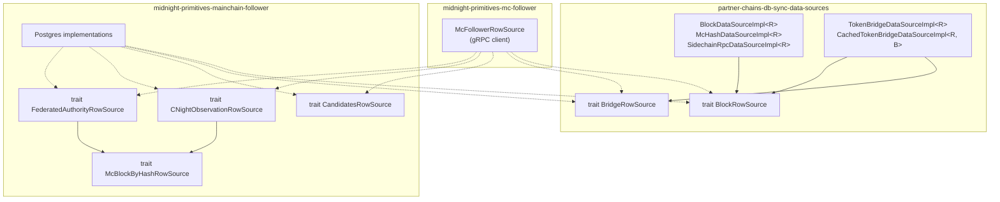

# mc-follower: node interface contract

Companion to `proto/mc_follower.proto` (the wire contract) and [SPEC.md](SPEC.md) (the design). This document maps every RPC to the SQL it replaces, names the node's row-source traits, and lists the db-sync data-model semantics the indexer reproduces.

The node side is [midnight-node PR #2498](https://github.com/midnightntwrk/midnight-node/pull/2498). `path:line` references below are into midnight-node at tag `node-2.1.101`, the release the change is based on; lines may have moved since. Abbreviations:

- `PC` = `partner-chains/toolkit/data-sources/db-sync/src`
- `MF` = `primitives/mainchain-follower/src`
- `CDS` = `MF/data_source/candidates_data_source`

Statements marked **(unverified)** depend on db-sync, cardano-serialization-lib or Postgres behaviour that was not checked against a running db-sync.

## 1. RPC to SQL map

Frequency legend:

- **per block**: on every Midnight block authored or imported (through an inherent data provider), unless an in-memory cache answers.
- **on cache miss**: only when the data source's own cache cannot answer.
- **per epoch**: effectively once per Cardano epoch, because results are cached once the epoch is stable.
- **RPC only**: reached only from node JSON-RPC or CLI query commands in node-2.1.101, never from block production or import.
- **error path**: only after another check failed.

| RPC | Replaces (SQL origin) | Data source and trait method | Frequency |
|---|---|---|---|
| `GetStatus` | none (new) | none in existing logic; health/startup probe | operator / startup |
| `GetLatestBlock` | `get_latest_block_info`, `PC/db_model.rs:217` | `BlockDataSourceImpl::get_latest_block_info` (`PC/block/mod.rs:107`) used by `McHashDataSource::get_latest_stable_block_for` (`PC/block/mod.rs:121`), `SidechainRpcDataSource::get_latest_block_info` (`PC/sidechain_rpc/mod.rs:29`), `is_cardano_tip_fresh` (`PC/block/mod.rs:163`); also `is_cardano_ok` (`:179`), `get_stable_block_by_hash_from_db` (`:403`), `fill_cache` (`:457`); bridge `get_latest_stable_block` (`PC/bridge/cache.rs:240`) | per authored block (`sidechain-mc-hash/src/lib.rs:381`); per imported block on stable-block cache miss (`lib.rs:533`); bridge on cache miss; error path for freshness checks (`lib.rs:543,562`); RPC (`node/src/rpc.rs:176`) |
| `GetBlocksByNumberRange` | `get_blocks_by_numbers`, `PC/db_model.rs:244` | `BlockDataSourceImpl::fill_cache` (`PC/block/mod.rs:466`) | on cache miss (mc_hash stable-block cache, at most 101 blocks) |
| `GetHighestBlockInWindow` | `get_highest_block`, `PC/db_model.rs:270` | `BlockDataSourceImpl::get_latest_block` (`PC/block/mod.rs:306`), reached from `get_latest_stable_block_for` (`:124`) and `is_cardano_ok` (`:192`) | per authored block; bridge on cache miss (`PC/bridge/cache.rs:243`); error path |
| `GetBlockByHash` | `get_block_by_hash`, `PC/db_model.rs:297` and `get_block_by_hash`, `MF/db/queries/cnight_observation.rs:369` (adds `tx_count`) | `BlockDataSourceImpl::get_block_by_hash` (`PC/block/mod.rs:151`, behind the 100-block cache), `get_stable_block_by_hash_from_db` (`:411`); `TokenBridgeDataSourceImpl::get_transfers` (`PC/bridge/mod.rs:97`, uncached variant, not wired in the node); cNIGHT `get_utxos_up_to_capacity` (`MF/data_source/cnight_observation.rs:147`); federated `get_federated_authority_data` (`MF/data_source/federated_authority_observation.rs:96`) | per block (cNIGHT); per distinct Cardano block hash (federated, LRU at `:88`); per block through the block cache (bridge `PC/bridge/cache.rs:138`, mc_hash parent lookups `sidechain-mc-hash/src/lib.rs:390,467`) |
| `GetTxPosition` | `get_block_info_for_tx_hash`, `PC/db_model.rs:710` | `TokenBridgeDataSource::get_transfers` via `resolve_tx_position` (`PC/bridge/cache.rs:257`; uncached `PC/bridge/mod.rs:140`) | on cache miss (checkpoint tx not in the bridge tx cache) |
| `GetBridgeTxs` | `get_bridge_txs`, `PC/db_model.rs:732` | `CachedTokenBridgeDataSourceImpl::fill_cache` (`PC/bridge/cache.rs:210`); uncached `get_transfers` (`PC/bridge/mod.rs:118`) | on cache miss (bridge cache, lookahead 1000 blocks, `node/src/main_chain_follower.rs:211`) |
| `GetLatestBlockForEpoch` | `get_latest_block_for_epoch`, `CDS/db_model.rs:210` | `CandidatesDataSourceImpl::get_last_block_for_epoch` (`CDS/mod.rs:171`) from `get_candidates` | RPC only (`get_candidates` is not called by the inherent: `authority-selection-inherents/src/authority_selection_inputs.rs:150` hard-codes empty registered candidates) |
| `GetLatestStableEpoch` | `get_latest_stable_epoch`, `CDS/db_model.rs:228` | `CandidateDataSourceCached::can_use_caching_for_request` (`CDS/cached.rs:219`) for `get_ariadne_parameters` and `get_candidates` | per block until the requested data epoch is known stable (then answered from `highest_seen_stable_epoch`, `CDS/cached.rs:214`) |
| `GetStakeDistribution` | `get_stake_distribution`, `CDS/db_model.rs:245` | `CandidatesDataSourceImpl::get_candidates` (`CDS/mod.rs:113`) | RPC only |
| `GetLatestTokenOutputForEpoch` | `get_token_utxo_for_epoch`, `CDS/db_model.rs:260` plus `MultiAssetCache::resolve_ident`, `MF/db/multi_asset_cache.rs:50` | `AuthoritySelectionDataSource::get_ariadne_parameters` (`CDS/mod.rs:78-85`) | per epoch (LRU for stable data epochs, `CDS/cached.rs:183-207`); per block while the data epoch is not yet stable |
| `GetEpochNonce` | `get_epoch_nonce`, `CDS/db_model.rs:289` | `AuthoritySelectionDataSource::get_epoch_nonce` (`CDS/mod.rs:128`) | per epoch once present (only `Some` is cached, `CDS/cached.rs:97`) |
| `GetUnspentOutputsAtAddress` | `get_utxos_for_address`, `CDS/db_model.rs:314` (variants `:330`, `:378`) | `CandidatesDataSourceImpl::get_registered_candidates` (`CDS/mod.rs:187`) from `get_candidates` | RPC only |
| `GetMappingRegistrations` | `get_registrations`, `MF/db/queries/cnight_observation.rs:27` | `MidnightCNightObservationDataSource::get_utxos_up_to_capacity` via `get_registration_utxos` (`MF/data_source/cnight_observation.rs:492`) | per block (`MF/idp/cnight_observation.rs:173`) |
| `GetMappingDeregistrations` | `get_deregistrations`, `MF/db/queries/cnight_observation.rs:84` | same, via `get_deregistration_utxos` (`cnight_observation.rs:552`) | per block |
| `GetAssetCreates` | `get_asset_creates`, `MF/db/queries/cnight_observation.rs:137` | same, via `get_asset_create_utxos` (`cnight_observation.rs:612`) | per block |
| `GetAssetSpends` | `get_asset_spends`, `MF/db/queries/cnight_observation.rs:188` | same, via `get_asset_spend_utxos` (`cnight_observation.rs:676`) | per block |
| `GetMaxTxSize` | `get_max_tx_size`, `MF/db/queries/cnight_observation.rs:453` | same, `cnight_observation.rs:170` (only for `ObservationBound::Cost`) | per block |
| `GetLatestGovernanceOutput` | `get_governance_body_utxo`, `MF/db/queries/federated_authority_observation.rs:29` | `FederatedAuthorityObservationDataSource::get_federated_authority_data` (`MF/data_source/federated_authority_observation.rs:107` council, `:141` technical committee) | per distinct Cardano block hash (two calls; `MF/idp/federated_authority_observation.rs:69`) |

Deliberately not mapped (Postgres implementation details or out of scope):

- `TxInConfiguration::from_connection` schema probes (`PC/db_model.rs:30`, `CDS/db_model.rs:79`).
- `MultiAssetCache::resolve_ident` (`MF/db/multi_asset_cache.rs:37`): folded into the requests as `(policy_id, asset_name)`.
- `get_low_bounds` / `get_high_bounds` (`MF/db/queries/cnight_observation.rs:396,426`): surrogate-id pre-filters. They select supersets of the position window, assuming db-sync ids grow with chain order (Postgres sequences never reuse values, rolled-back rows are re-inserted with new ids) **(unverified for every db-sync version)**.
- Index creation and autovacuum tuning (`CDS/db_model.rs:425-463`, `MF/db/queries/cnight_observation.rs:268-366`, `node/src/main_chain_follower.rs:117`).
- `get_epoch_for_block_hash` (`CDS/db_model.rs:301`, `CDS/mod.rs:398`): genesis CLI only (`node/src/command.rs:818,985`).
- partner-chains' own `CandidatesDataSourceImpl` (`PC/candidates`) and its `PC/db_model.rs:309-518` queries: not wired in the node (it uses Midnight's `CDS`).
- All `node/src/genesis/**` queries.

## 2. Row-source traits

Each data source of the node is generic over a small trait covering exactly the queries it makes. The Postgres code is the first implementation (default type parameters keep the existing constructors and the db-sync path unchanged); `McFollowerRowSource` in the crate `midnight-primitives-mc-follower` (`primitives/mc-follower`) implements every trait over gRPC.

| Trait | Location | RPCs |
|---|---|---|
| `BlockRowSource` | `PC/row_source.rs` | `GetLatestBlock`, `GetBlocksByNumberRange`, `GetHighestBlockInWindow`, `GetBlockByHash` |
| `BridgeRowSource` | `PC/row_source.rs` | `GetTxPosition`, `GetBridgeTxs` |
| `CandidatesRowSource` | `CDS/row_source.rs` | `GetLatestBlockForEpoch`, `GetLatestStableEpoch`, `GetStakeDistribution`, `GetLatestTokenOutputForEpoch`, `GetEpochNonce`, `GetUnspentOutputsAtAddress` |
| `McBlockByHashRowSource` | `MF/db/row_source.rs` | `GetBlockByHash` (with `tx_count`) |
| `CNightObservationRowSource` | `MF/db/row_source.rs` | `GetMaxTxSize`, `GetMappingRegistrations`, `GetMappingDeregistrations`, `GetAssetCreates`, `GetAssetSpends` |
| `FederatedAuthorityRowSource` | `MF/db/row_source.rs` | `GetLatestGovernanceOutput` |

Common rules:

- Row types are the existing structs, unchanged, so the post-processing code is untouched. Datum fields keep their decoded types; each implementation produces the same decoded value (section 3, S5).
- Postgres-only details stay behind the Postgres implementations: `tx_in` mode detection, multi-asset id caching, index creation. The cNIGHT id-range pre-filters (`get_low_bounds` / `get_high_bounds`) are an associated `Bounds` type of `CNightObservationRowSource`, so the db-sync path keeps running them once per block; the gRPC implementation uses `()`.
- An unknown asset yields no rows, which gives the same result as the db-sync path's "asset not in `multi_asset`" branch.

The exact signatures are in the PR.

## 3. db-sync semantics the indexer must reproduce

Each item: what the SQL relies on, then what the indexer stores.

**S1. Address matching is text equality on db-sync's rendering.** `tx_out.address = $1` in `get_utxos_for_address` (`CDS/db_model.rs:356,402`), `get_registrations` (`MF/db/queries/cnight_observation.rs:57`), `get_deregistrations` (`:113`), `get_bridge_txs` (`PC/db_model.rs:775,790,806,821,836,848`), `get_governance_body_utxo` (`MF/db/queries/federated_authority_observation.rs:50`). The node passes `MainchainAddress::to_string()` / config strings. Two different on-chain encodings that render to the same text both match; one that renders differently does not. Indexer: stores the db-sync-rendered address text (SPEC 4.addr) per watched output and filters on it, never on raw address bytes. `holder_address` in cNIGHT rows is the same text, which Rust parses as bech32 and skips if not a base address (`cnight_observation.rs:636-650`).

**S2. Queries without a spent-ness check.** `get_token_utxo_for_epoch` (`CDS/db_model.rs:265-281`), `get_governance_body_utxo` (whose doc comment states the assumption, `MF/db/queries/federated_authority_observation.rs:28`), `get_registrations`, `get_asset_creates` return outputs whether or not they were later spent. Indexer: keeps watched outputs (spends are recorded, not deletions).

**S3. Asset predicates differ per query.**
- Exact `(policy, name)`, any quantity: `get_token_utxo_for_epoch`, `get_asset_creates`, `get_asset_spends`, all four bridge subqueries.
- Exact `(policy, name)` and `quantity = 1`: `get_registrations` (`MF/db/queries/cnight_observation.rs:58-59`). Other assets on the output are irrelevant.
- Policy only, any name: `get_governance_body_utxo` (`ma.policy = $2`, `:51`).
- No asset predicate: `get_deregistrations`, `get_utxos_for_address`.
Indexer: per watched output, every `(policy, name, quantity)` it carries for the watched policies (quantity as unsigned 64-bit, db-sync `word64type`).

**S4. Row multiplication by joins.**
- `get_governance_body_utxo`: an output carrying k asset names of the policy appears k times (identical rows); harmless under `LIMIT 1`.
- `get_utxos_for_address`: the joins to the consuming `tx_in` and to the creating tx's inputs multiply rows, and `GROUP BY` collapses them back to one row per output with `array_agg` over the creating tx's inputs (`CDS/db_model.rs:344,358-367`). Indexer: the full input list of each transaction that created a watched committee-candidate output.
- `ma_tx_out` has one row per (output, asset) (a ledger `MultiAsset` value is a map), so per-asset joins do not multiply rows **(unverified that db-sync never writes duplicates)**.
- Bridge sums are subquery aggregates per transaction and `relevant_txs` is `DISTINCT` (`PC/db_model.rs:860-870`): one row per transaction.

**S5. Datums.**
- Resolution: `tx_out.data_hash = datum.hash` (`LEFT JOIN` in `CDS/db_model.rs:277,354,400`; `INNER JOIN` in `MF/db/queries/cnight_observation.rs:51,111` and `federated_authority_observation.rs:45`). db-sync fills `tx_out.data_hash` for both inline and hash-only datums and inserts a `datum` row for inline datums and for witness-set datums of valid transactions (SPEC 4.datum). The `datum` table is global: it reflects every datum seen up to db-sync's current tip, not up to the query's block bound. A hash-only output whose datum is revealed later becomes resolvable for all past queries (see R3).
- Decoding today: `datum.value` (db-sync's detailed-schema JSON, stored as `jsonb`) goes through sqlx `JsonValue` and `encode_json_value_to_plutus_datum(_, DetailedSchema)` (`MF/db/types.rs:41-79`, `PC/db_datum.rs:23-56`). Two decoders:
  - `DbDatumIfValid` (NULL or undecodable gives `None`, row kept): registrations, deregistrations, address outputs.
  - strict `DbDatum` (undecodable fails the whole query): token output (`TokenTxOutput.datum: Option<DbDatum>`, NULL gives `None`), governance (`GovernanceBodyUtxoRow.full_datum: DbDatum`).
  The JSON path can reject data the CBOR decoder accepts: serde_json refuses nesting at 128 levels (comment at `MF/db/types.rs:67`: a datum of 64 nested lists reaches it), and the test fixture comment at `CDS/mod.rs:456` names a 2^64 integer datum as undecodable. The workspace enables `cardano-serialization-lib` feature `arbitrary-precision-json` (`Cargo.toml:169`), so which layer rejects the 2^64 integer is **(unverified)**.
- Indexer: every datum db-sync would put in its `datum` table from the start point on, by hash, with its original bytes (inline or witness) and the block that first revealed it. It serves bytes only.
- Rust side (gRPC client): one function that reproduces the JSON path: decode CBOR with CSL, render with CSL's `DetailedSchema` JSON encoder, serialise to text, parse with serde_json (this re-applies the 128-level limit exactly), then `encode_json_value_to_plutus_datum`. `DbDatumIfValid` positions map `Err` to `None`; strict positions propagate the error. This assumes CSL's detailed-schema JSON has the same shape as db-sync's (cardano-api `ScriptDataJsonDetailedSchema`) **(unverified; needs parity tests on the fixtures in `PC/../testdata/migrations-tx-in-*`)**. `datum.value` NULL with a present `datum` row cannot happen under the required db-sync options (`PC/lib.rs:65`, `remove_jsonb_from_schema` disabled) **(unverified)**.

**S6. Transaction metadata (bridge).** `LEFT JOIN tx_metadata ON tx_id AND key = 6500973` (`PC/db_model.rs:874`). db-sync stores one row per (transaction, label) for valid transactions only (SPEC 4.meta), `json` rendered with cardano-api's no-schema JSON (text as JSON string, bytes as `"0x"`-prefixed hex string, lists as arrays) **(unverified rendering details)**. The only consumer is `metadata_to_recipient` (`PC/bridge/mod.rs:227-249`), which accepts exactly a one-element array holding a string `"0x<hex>"` whose decoded bytes convert to the recipient; anything else (NULL, undecodable, other shape) gives `TransferRecipient::Invalid`. Equivalent CBOR rule for the gRPC client: recipient bytes exist iff the metadatum is a list of exactly one element that is either bytes `b` (rendered `"0x"+hex(b)`, decodes back to `b`) or text starting with `"0x"` whose remainder hex-decodes. Deeply nested or NUL-containing metadata gives `Invalid` on both paths. Indexer: per relevant bridge transaction, the CBOR of the label-6500973 metadatum.

**S7. NULL `block_no` (EBBs).** `get_latest_block_info` and `get_latest_block_for_epoch` exclude NULL explicitly (`PC/db_model.rs:230`, `CDS/db_model.rs:218`); range predicates exclude it implicitly. By-hash lookups would return an EBB row whose NULL `block_no` fails to decode. Indexer: EBBs need not be stored (no index entry); see R9.

**S8. Epoch of a block.** `block.epoch_no` is used as a filter (`epoch_no <= E` in `CDS/db_model.rs:218,279`), as a join key (`epoch_param.epoch_no = block.epoch_no`, `MF/db/queries/cnight_observation.rs:458`), in `stable_block.epoch_no - 1` (`CDS/db_model.rs:232`), and returned in rows. It is the epoch containing the block's slot under the era history. Indexer: `epoch_no` per block.

**S9. `tx_count` and `block_index`.** Both count phase-2-invalid transactions (SPEC 4.txidx). `tx_count` becomes the tip's `CardanoPosition.tx_index_in_block` (`MF/db/types.rs:106`) and, after `increment()` (`cnight_observation.rs:179`), the exclusive upper bound of the cNIGHT window. Indexer: `tx_count` per block, `tx_index` per transaction.

**S10. The two `tx_in` modes.** Postgres code detects `tx_in`-table mode vs `consumed_by_tx_id` mode (`PC/db_model.rs:29-51`, `CDS/db_model.rs:78-100`) for `get_bridge_txs` and `get_utxos_for_address`. The cNIGHT queries `get_deregistrations` and `get_asset_spends` use the `tx_in` table unconditionally (`MF/db/queries/cnight_observation.rs:107,212`), so against a db-sync in consumed mode they return no rows. The gRPC semantics must equal the `tx_in`-table mode (the db-sync default, `PC/lib.rs:56`). Whether the two modes agree on phase-2-invalid transactions (collateral inputs marked as consumed) is **(unverified)**.

**S11. What counts as a spend.** Regular inputs of valid transactions and collateral inputs of phase-2-invalid transactions (SPEC 4.invalid); never reference inputs (db-sync `reference_tx_in`) or collateral inputs of valid transactions. For `get_utxos_for_address` an output counts as unspent at block B iff it was not spent in any block <= B (`consuming_block.block_no > $2`, `CDS/db_model.rs:357,403`). Indexer: per watched output, the spending transaction (hash, block_no, tx_index), and, for deregistrations and asset spends, enough to enumerate (spending tx, spent output) pairs ordered by spending position.

**S12. Block time.** db-sync `block.time` is a `timestamp` holding slot start time in whole seconds (SPEC 4.time). Rust converts to seconds (`PC/db_model.rs:101`), keeps `NaiveDateTime` for window checks (`PC/block/mod.rs:323-334`), and to milliseconds for cNIGHT (`MF/db/types.rs:105`, `cnight_observation.rs:505`). Indexer: seconds per block.

**S13. Stake distribution.** `SUM(epoch_stake.amount)` grouped by pool for `epoch_no = E` (`CDS/db_model.rs:250-254`), with SPEC section 3 defining equality. Rust treats "no rows" as "no stake data" (every candidate gets `stake_delegation: None`, `CDS/mod.rs:235-237`), distinct from a pool missing in a non-empty map (`Some(0)`). Indexer: per epoch, per pool stake, plus a completeness flag; serve nothing until complete (R7).

**S14. Epoch parameters.** `epoch_param.nonce` (`CDS/db_model.rs:293`) and `epoch_param.max_tx_size` (`MF/db/queries/cnight_observation.rs:458`). The row for epoch E appears when db-sync processes the first block of epoch E **(unverified timing)**. Indexer: the nonce from the shipped table, nonces supplied at run time or the nonce driver (which records it with the first block of the epoch); `max_tx_size` from a local node or the per-network table, guarded by the tripwire on proposals and committee votes. What the indexer does not know is answered `UNAVAILABLE`, never absent.

**S15. Current-chain answers.** No query is bounded to stable blocks unless the caller passes a bound; `get_token_utxo_for_epoch` and `get_latest_block_for_epoch` read volatile blocks too. Indexer: the volatile window with rollback (SPEC section 2).

## 4. Logic that stays in Rust and the raw facts it needs

| Logic | Location | Config / clock inputs | Raw facts from the indexer |
|---|---|---|---|
| Stable block for authoring: `latest.number - (k + block_stability_margin)` then highest block in the time window `[ref - 3k/f, ref - k/f]` | `PC/block/mod.rs:116-126`, `:297-318` | `cardano_security_parameter`, `block_stability_margin`, `cardano_active_slots_coeff`, slot duration, reference timestamp (Midnight slot start) | `GetLatestBlock`, `GetHighestBlockInWindow` |
| Stable block verification (not found / not enough confirmations / timestamp out of range) | `PC/block/mod.rs:398-447` | k, time window, reference timestamp | `GetLatestBlock` (number), `GetBlockByHash` (number, time) |
| Stable-block cache fill: up to 100 blocks, capped at `latest - k` | `PC/block/mod.rs:450-476` | k, `cache_size` | `GetLatestBlock`, `GetBlocksByNumberRange` |
| Time to slot conversion for window bounds | `PC/block/mod.rs:478-493` | `MainchainEpochConfig` (node config) | none |
| `is_cardano_tip_fresh`: tip age < `max(margin,1) * slot/f` seconds | `PC/block/mod.rs:160-169`, `:330-334` | wall clock (`SystemTimeSource`), margin, f, slot duration | `GetLatestBlock` (time) |
| `is_cardano_ok`: Praos chain quality and growth | `PC/block/mod.rs:176-197` | wall clock, k, window | `GetLatestBlock`, `GetHighestBlockInWindow` |
| Bridge cache upper bound: `min(to + lookahead, latest stable)` where "latest stable" uses the latest block's own timestamp as reference | `PC/bridge/cache.rs:205-208`, `:237-246` | `BRIDGE_TRANSFER_CACHE_LOOKAHEAD` (`node/src/main_chain_follower.rs:211`), plus the block-source config | `GetLatestBlock`, `GetHighestBlockInWindow` |
| Candidate cache admission: data epoch <= latest stable epoch | `CDS/cached.rs:209-229` | k (`CARDANO_SECURITY_PARAMETER`) | `GetLatestStableEpoch` |
| Data epoch offset (`epoch - 2`) | `CDS/mod.rs:339-350`, `sidechain/domain/src/lib.rs:56` | constant | none |
| cNIGHT page limits, cost admission, frontier, cursor | `MF/data_source/cnight_observation.rs:252-275`, `:365-438` | `ObservationBound` from the runtime, `MIN_ROW_BYTES` | row counts, positions, `GetMaxTxSize`, tip `tx_count` |
| Federated authority cache | `federated_authority_observation.rs:84-91` (LRU lookup at `:88`) | none | none |

`GetStatus` is not needed by any of these; all existing freshness logic derives from `GetLatestBlock`.

## 5. Ambiguities and how they are resolved

**R1. Non-total `ORDER BY ... LIMIT 1`.** `get_token_utxo_for_epoch` orders by `(block_no DESC, block_index DESC)` (`CDS/db_model.rs:280`) and `get_governance_body_utxo` likewise (`federated_authority_observation.rs:53`). Two qualifying outputs in one transaction tie and Postgres picks either, so two db-sync nodes can already disagree. The indexer breaks the tie by output index DESC. If the permissioned-candidates and governance tokens are single NFTs the tie is unreachable **(unverified)**.

**R2. No `ORDER BY` at all.** `get_utxos_for_address` (`CDS/db_model.rs:330-422`) and `get_stake_distribution` (`:245`). Stake order is unobservable (folded into a map). Address outputs are streamed by `(block_no, tx_index, output_index)` and stake by `pool_hash`; RPC output order can differ from a db-sync node's.

**R3. Datum resolution horizon.** db-sync resolves `data_hash` against its global `datum` table (its current tip), not against the query's block bound. The indexer does the same: a datum is resolvable once any block it has applied revealed it.

**R4. Datums revealed before the indexer's start point.** The indexer records every datum db-sync would from its start point on, but not before. A watched output whose datum was revealed only earlier is unresolvable here and resolvable in db-sync. Start points must precede every such datum (SPEC section 8).

**R5. Datum decoding parity.** The node's client turns the CBOR into the same `Option`/error outcome as the db-sync JSON path (CBOR to cardano-serialization-lib to detailed-schema JSON text to serde_json, which re-applies its 128-level nesting limit). Risks remain where cardano-serialization-lib and cardano-ledger disagree on CBOR, or its detailed JSON differs from db-sync's **(unverified)**.

**R6. db-sync configuration dependence.** In `consumed_by_tx_id` mode the cNIGHT spend and deregistration queries return nothing (S10), so two db-sync nodes with different settings already disagree. The gRPC semantics are those of the `tx_in`-table mode, the default configuration.

**R7. Stake distribution completeness.** db-sync writes `epoch_stake` for a new epoch in chunks after the boundary **(unverified for 13.8)**, so it can briefly return a partial distribution. The indexer serves a distribution only when it is complete, and `UNAVAILABLE` before that (empty only for pre-Shelley epochs, where db-sync has no rows).

**R8. Overflow handling.** Bridge sums are unbounded `NUMERIC` decoded with `to_u64` (`PC/db_model.rs:208-214`): sent as `Uint128`, and the client fails above `u64::MAX`. cNIGHT quantities are cast `::BIGINT` (`MF/db/queries/cnight_observation.rs:152,205`): sent as `uint64`, and the client fails above `i64::MAX`. Postgres may raise the cast error for a matching row it does not return **(unverified planner behaviour)**; the client fails only on returned rows. Total cNIGHT supply is far below `i64::MAX`.

**R9. EBB hash lookups.** db-sync returns a row that fails to decode; the indexer returns absent. Midnight never references pre-Shelley blocks.

**R10. Consistency across RPCs within one data-source call.** cNIGHT resolves the tip by hash and then runs the range queries (`cnight_observation.rs:147-249`); a rollback in between makes the db-sync path fail, while the gRPC path continues on the new chain. Federated authority and the bridge follow the same pattern. The proto has no anchor field to detect this.

**R11. Error model.** Absence is encoded in the response where db-sync would have no row. `UNAVAILABLE` where the indexer cannot answer (no store, nothing indexed, a bound beyond the tip, an incomplete epoch while not caught up with the upstream (R16), epoch data not known yet); `FAILED_PRECONDITION` for an address or policy the indexer does not index; `INVALID_ARGUMENT` for malformed requests. See the proto.

**R12. Blocks and transactions before the start point.** db-sync has every block since genesis; the indexer starts at a configured point. `GetBlockByHash`, `GetTxPosition` and `GetLatestBlockForEpoch` for earlier data return absent instead of a row. The start point must precede Midnight's genesis reference; `GetStatus.start_block` makes a misconfiguration visible.

**R13. Phase-2-invalid inline datums.** db-sync stores the inline datum of every output it writes, the collateral-return output of an invalid transaction included; so does the indexer.

**R14. `GetLatestStableEpoch` returning -1.** Possible only when the stable block is in epoch 0; Rust fails to decode it. The server returns the signed value and the client fails.

**R15. `GetBlockByHash` merges two SQL queries.** The partner-chains row lacks `tx_count`; the Midnight row has it. One RPC returns the superset.

**R16. Epoch-bounded queries for the tip's epoch and later.** `get_latest_block_for_epoch` and `get_token_utxo_for_epoch` answer from every block with `epoch_no <= E`. db-sync has no bound on `E`: for the epoch its tip is in, or any later one (the `systemParameters_getAriadneParameters` RPC passes whatever epoch it is given), it returns the latest matching row up to its tip, and that answer changes with each further block. The indexer answers an epoch below its tip's epoch always (complete: a later block is indexed). For the tip's epoch and later it answers as db-sync does, from the blocks up to its tip, only while it is caught up with its upstream: it follows the chain itself and `GetStatus` would report `syncing = false` (the indexed tip's block number is at least the upstream tip's last reported by chain-sync, and no stake distribution backfill is outstanding). Then its blocks are those of a synced db-sync. Otherwise (behind the upstream, no upstream tip reported yet, a backfill outstanding, or a server run with `--no-sync`) it answers `UNAVAILABLE`, since the answer would be a stale view of the tip's epoch. The node's committee selection asks for the data epoch, two epochs before the one in use, which is complete in normal operation.

## 6. Storage

The schema is in `McFollower.Store.Schema`. Rows created by a block carry the block's position on the indexed chain (`block_id`), so a rollback deletes by `block_id > n`; positions used by queries are copied onto the output and asset rows so that every query is an index range scan.

| Table | Holds | Serves |
|---|---|---|
| `block` | Every block: hash, number, slot, epoch, time, tx count | the block RPCs, `GetLatestBlockForEpoch`, `GetLatestStableEpoch`, epoch of `GetMaxTxSize` |
| `tx` | Every transaction: hash, position | `GetTxPosition` |
| `tx_out` | Watched outputs: address text, datum hash, spending position | every output query |
| `ma_tx_out` | Assets of watched outputs, with positions copied | asset, governance, registration and bridge queries |
| `tx_input` | Input lists of transactions creating committee-candidate outputs | `tx_inputs` of `GetUnspentOutputsAtAddress` |
| `datum` | Datums by hash, original bytes | datum resolution (R3, R4) |
| `tx_metadata` | Watched metadata labels of valid transactions | `GetBridgeTxs` |
| `nonce_checkpoint`, `epoch_nonce` | The nonce driver's state per block in the volatile window, the epoch nonces it produced | `GetEpochNonce`, restarts |
| `supplied_epoch_nonce` | Epoch nonces given at run time (`--epoch-nonces`) | `GetEpochNonce` |
| `nonce_divergence` | Whether the driver disagrees with a local node | `GetEpochNonce` |
| `max_tx_size_sighting`, `committee_vote` | Proposals that would change `max_tx_size`, constitutional committee votes | `GetMaxTxSize` (tripwire) |
| `epoch_param` | `max_tx_size` read from a local node | `GetMaxTxSize` |
| `epoch_stake`, `pool_stake` | Stake distributions and whether they are complete | `GetStakeDistribution` |
