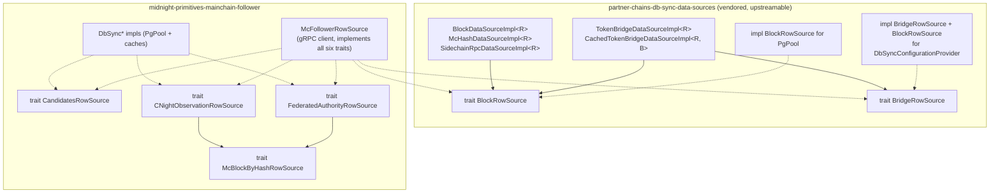

# mc-follower: node interface contract (draft)

Companion to `proto/mc_follower.proto` (wire contract) and `docs/SPEC.md` (settled decisions). This document maps every RPC to the SQL it replaces, proposes the Rust row-source traits, and lists the db-sync data-model semantics the indexer has to reproduce.

Node reference: `../midnight-node`, branch `mc-follower-data-source`, tag `node-2.1.101`. All `path:line` references are into that tree and were read for this draft; nothing was compiled or run. Abbreviations:

- `PC` = `partner-chains/toolkit/data-sources/db-sync/src`
- `MF` = `primitives/mainchain-follower/src`
- `CDS` = `MF/data_source/candidates_data_source`

Statements marked **(unverified)** could not be confirmed from the node source alone (they depend on db-sync, cardano-serialization-lib or Postgres behaviour, or on compiling).

Items under "Recommendation" are proposals awaiting your decision, not decisions.

## 1. RPC to SQL map

Frequency legend:

- **per block**: on every Midnight block authored or imported (through an inherent data provider), unless an in-memory cache answers.
- **on cache miss**: only when the data source's own cache cannot answer.
- **per epoch**: effectively once per Cardano epoch, because results are cached once the epoch is stable.
- **RPC only**: reached only from node JSON-RPC or CLI query commands in node-2.1.101, never from block production or import.
- **error path**: only after another check failed.

| RPC | Replaces (SQL origin) | Data source and trait method | Frequency |
|---|---|---|---|
| `GetStatus` | none (new) | none in existing logic; health/startup probe | operator / startup |
| `GetLatestBlock` | `get_latest_block_info`, `PC/db_model.rs:217` | `BlockDataSourceImpl::get_latest_block_info` (`PC/block/mod.rs:107`) used by `McHashDataSource::get_latest_stable_block_for` (`PC/block/mod.rs:121`), `SidechainRpcDataSource::get_latest_block_info` (`PC/sidechain_rpc/mod.rs:29`), `is_cardano_tip_fresh` (`PC/block/mod.rs:163`); also `is_cardano_ok` (`:179`), `get_stable_block_by_hash_from_db` (`:403`), `fill_cache` (`:457`); bridge `get_latest_stable_block` (`PC/bridge/cache.rs:240`) | per authored block (`sidechain-mc-hash/src/lib.rs:381`); per imported block on stable-block cache miss (`lib.rs:533`); bridge on cache miss; error path for freshness checks (`lib.rs:543,562`); RPC (`node/src/rpc.rs:176`) |
| `GetBlocksByNumberRange` | `get_blocks_by_numbers`, `PC/db_model.rs:244` | `BlockDataSourceImpl::fill_cache` (`PC/block/mod.rs:466`) | on cache miss (mc_hash stable-block cache, at most 101 blocks) |
| `GetHighestBlockInWindow` | `get_highest_block`, `PC/db_model.rs:270` | `BlockDataSourceImpl::get_latest_block` (`PC/block/mod.rs:306`), reached from `get_latest_stable_block_for` (`:124`) and `is_cardano_ok` (`:192`) | per authored block; bridge on cache miss (`PC/bridge/cache.rs:243`); error path |
| `GetBlockByHash` | `get_block_by_hash`, `PC/db_model.rs:297` and `get_block_by_hash`, `MF/db/queries/cnight_observation.rs:369` (adds `tx_count`) | `BlockDataSourceImpl::get_block_by_hash` (`PC/block/mod.rs:151`, behind the 100-block cache), `get_stable_block_by_hash_from_db` (`:411`); `TokenBridgeDataSourceImpl::get_transfers` (`PC/bridge/mod.rs:97`, uncached variant, not wired in the node); cNIGHT `get_utxos_up_to_capacity` (`MF/data_source/cnight_observation.rs:147`); federated `get_federated_authority_data` (`MF/data_source/federated_authority_observation.rs:96`) | per block (cNIGHT); per distinct Cardano block hash (federated, LRU at `:88`); per block through the block cache (bridge `PC/bridge/cache.rs:138`, mc_hash parent lookups `sidechain-mc-hash/src/lib.rs:390,467`) |
| `GetTxPosition` | `get_block_info_for_tx_hash`, `PC/db_model.rs:710` | `TokenBridgeDataSource::get_transfers` via `resolve_tx_position` (`PC/bridge/cache.rs:257`; uncached `PC/bridge/mod.rs:140`) | on cache miss (checkpoint tx not in the bridge tx cache) |
| `GetBridgeTxs` | `get_bridge_txs`, `PC/db_model.rs:732` | `CachedTokenBridgeDataSourceImpl::fill_cache` (`PC/bridge/cache.rs:210`); uncached `get_transfers` (`PC/bridge/mod.rs:118`) | on cache miss (bridge cache, lookahead 1000 blocks, `node/src/main_chain_follower.rs:211`) |
| `GetLatestBlockForEpoch` | `get_latest_block_for_epoch`, `CDS/db_model.rs:210` | `CandidatesDataSourceImpl::get_last_block_for_epoch` (`CDS/mod.rs:171`) from `get_candidates` | RPC only (`get_candidates` is not called by the inherent: `authority-selection-inherents/src/authority_selection_inputs.rs:150` hard-codes empty registered candidates) |
| `GetLatestStableEpoch` | `get_latest_stable_epoch`, `CDS/db_model.rs:228` | `CandidateDataSourceCached::can_use_caching_for_request` (`CDS/cached.rs:219`) for `get_ariadne_parameters` and `get_candidates` | per block until the requested data epoch is known stable (then answered from `highest_seen_stable_epoch`, `CDS/cached.rs:214`) |
| `GetStakeDistribution` | `get_stake_distribution`, `CDS/db_model.rs:245` | `CandidatesDataSourceImpl::get_candidates` (`CDS/mod.rs:113`) | RPC only |
| `GetLatestTokenOutputForEpoch` | `get_token_utxo_for_epoch`, `CDS/db_model.rs:260` plus `MultiAssetCache::resolve_ident`, `MF/db/multi_asset_cache.rs:50` | `AuthoritySelectionDataSource::get_ariadne_parameters` (`CDS/mod.rs:78-85`) | per epoch (LRU for stable data epochs, `CDS/cached.rs:183-207`); per block while the data epoch is not yet stable |
| `GetEpochNonce` | `get_epoch_nonce`, `CDS/db_model.rs:289` | `AuthoritySelectionDataSource::get_epoch_nonce` (`CDS/mod.rs:128`) | per epoch once present (only `Some` is cached, `CDS/cached.rs:97`) |
| `GetUnspentOutputsAtAddress` | `get_utxos_for_address`, `CDS/db_model.rs:314` (variants `:330`, `:378`) | `CandidatesDataSourceImpl::get_registered_candidates` (`CDS/mod.rs:187`) from `get_candidates` | RPC only |
| `GetMappingRegistrations` | `get_registrations`, `MF/db/queries/cnight_observation.rs:27` | `MidnightCNightObservationDataSource::get_utxos_up_to_capacity` via `get_registration_utxos` (`MF/data_source/cnight_observation.rs:492`) | per block (`MF/idp/cnight_observation.rs:173`) |
| `GetMappingDeregistrations` | `get_deregistrations`, `MF/db/queries/cnight_observation.rs:84` | same, via `get_deregistration_utxos` (`cnight_observation.rs:552`) | per block |
| `GetAssetCreates` | `get_asset_creates`, `MF/db/queries/cnight_observation.rs:137` | same, via `get_asset_create_utxos` (`cnight_observation.rs:612`) | per block |
| `GetAssetSpends` | `get_asset_spends`, `MF/db/queries/cnight_observation.rs:188` | same, via `get_asset_spend_utxos` (`cnight_observation.rs:676`) | per block |
| `GetMaxTxSize` | `get_max_tx_size`, `MF/db/queries/cnight_observation.rs:453` | same, `cnight_observation.rs:170` (only for `ObservationBound::Cost`) | per block |
| `GetLatestGovernanceOutput` | `get_governance_body_utxo`, `MF/db/queries/federated_authority_observation.rs:29` | `FederatedAuthorityObservationDataSource::get_federated_authority_data` (`MF/data_source/federated_authority_observation.rs:107` council, `:141` technical committee) | per distinct Cardano block hash (two calls; `MF/idp/federated_authority_observation.rs:69`) |

Deliberately not mapped (Postgres implementation details or out of scope):

- `TxInConfiguration::from_connection` schema probes (`PC/db_model.rs:30`, `CDS/db_model.rs:79`).
- `MultiAssetCache::resolve_ident` (`MF/db/multi_asset_cache.rs:37`): folded into the requests as `(policy_id, asset_name)`.
- `get_low_bounds` / `get_high_bounds` (`MF/db/queries/cnight_observation.rs:396,426`): surrogate-id pre-filters. They select supersets of the position window, assuming db-sync ids grow with chain order (Postgres sequences never reuse values, rolled-back rows are re-inserted with new ids) **(unverified for every db-sync version)**.
- Index creation and autovacuum tuning (`CDS/db_model.rs:425-463`, `MF/db/queries/cnight_observation.rs:268-366`, `node/src/main_chain_follower.rs:117`).
- `get_epoch_for_block_hash` (`CDS/db_model.rs:301`, `CDS/mod.rs:398`): genesis CLI only (`node/src/command.rs:818,985`).
- partner-chains' own `CandidatesDataSourceImpl` (`PC/candidates`) and its `PC/db_model.rs:309-518` queries: not wired in the node (it uses Midnight's `CDS`).
- All `node/src/genesis/**` queries.

## 2. Row-source traits

### 2.1 Layering



Common rules for every trait below:

- `#[async_trait]`, supertraits `Send + Sync + 'static` (needed by `observed_async_trait!` / `#[async_trait]` on generic impls).
- Error type `Box<dyn std::error::Error + Send + Sync>` (the type every data-source trait already returns). The Postgres impls box their `SqlxError` / `sqlx::Error`.
- Row types are the existing structs, unchanged, so the post-processing code is untouched. Datum fields keep their decoded types (`Option<DbDatum>`, `DbDatum`, `Option<PlutusData>`); each implementation is responsible for producing the same decoded value (section 3, S5).
- Every generic struct gets a default type parameter equal to today's Postgres type, so existing constructors (`new(pool, ..)`, `from_config(pool, ..)`), the node wiring and the existing tests (including struct literals such as `PC/block/tests.rs:376`) compile unchanged **(unverified: not compiled)**.
- `tx_in` mode detection, multi-asset id caching and id-bound pre-filtering move behind the Postgres implementations.

Recommendation on placement of the gRPC implementation: a module `MF/mc_follower/` behind a new cargo feature of `midnight-primitives-mainchain-follower` (it already depends on `partner-chains-db-sync-data-sources`, `MF/../Cargo.toml:24`), holding the tonic-generated client and `McFollowerRowSource`. This keeps the vendored `partner-chains/` change limited to traits and generics (upstreamable on its own) and avoids a new crate. Alternative: a new workspace crate `primitives/mc-follower-client`. Needs your decision.

Consequence either way: the partner-chains row types must become `pub` and be re-exported (today `mod db_model` is private, `PC/lib.rs:112`): `Block` (`PC/db_model.rs:85`), `TxBlockInfo` (`:704`), `BridgeTx` and its `pub(crate)` fields (`:639-658`), `ResolvedBridgeDataCheckpoint` (`:675`), `TxOrderingKey` (`:671`), `NativeTokenAmount` (already `pub`, `:174`). The Midnight row types in `CDS/db_model.rs` (`Block :134`, `MainchainTxOutput :142`, `StakePoolEntry :190`, `TokenTxOutput :196`, `MainchainEpochNonce :208`) are `pub(crate)`; they stay crate-private if the gRPC impl lives in the same crate.

### 2.2 Block (mc_hash, sidechain_rpc, block lookups)

Location: new module `PC/row_source.rs` in `partner-chains-db-sync-data-sources`, gated by `feature = "block-source"`, re-exported from `PC/lib.rs`.

```rust
#[async_trait]
pub trait BlockRowSource: Send + Sync + 'static {
    /// GetLatestBlock. Replaces db_model::get_latest_block_info (PC/db_model.rs:217).
    async fn get_latest_block_info(&self) -> Result<Option<Block>, BoxError>;
    /// GetBlocksByNumberRange. Replaces db_model::get_blocks_by_numbers (PC/db_model.rs:244).
    async fn get_blocks_by_numbers(&self, from: BlockNumber, to: BlockNumber)
        -> Result<Vec<Block>, BoxError>;
    /// GetHighestBlockInWindow. Replaces db_model::get_highest_block (PC/db_model.rs:270).
    async fn get_highest_block(&self, max_block_number: BlockNumber,
        min_time: NaiveDateTime, min_slot: SlotNumber,
        max_time: NaiveDateTime, max_slot: SlotNumber) -> Result<Option<Block>, BoxError>;
    /// GetBlockByHash. Replaces db_model::get_block_by_hash (PC/db_model.rs:297).
    async fn get_block_by_hash(&self, hash: McBlockHash) -> Result<Option<Block>, BoxError>;
}

impl BlockRowSource for sqlx::PgPool { /* each method calls the existing db_model fn */ }
```

Row type: `Block { block_no, hash, epoch_no, slot_no, time: NaiveDateTime }` (`PC/db_model.rs:85`).

Functions that become generic (`impl<R: BlockRowSource> BlockDataSourceImpl<R>`; struct becomes `BlockDataSourceImpl<R = PgPool>` with the field still named `pool: R`, `PC/block/mod.rs:67`):

- `get_latest_block_info` (`PC/block/mod.rs:104`), `get_latest_stable_block_for` (`:116`), `get_stable_block_for` (`:130`), `get_block_by_hash` (`:140`), `is_cardano_tip_fresh` (`:160`), `is_cardano_ok` (`:176`), `get_latest_block` (`:297`), `is_stable_block_time_valid` / `is_block_fresh` / metrics helpers (`:323-348`, no I/O but in the same impl block), `get_stable_block_by_hash` (`:350`), `get_stable_block_by_hash_from_cache` (`:383`), `get_stable_block_by_hash_from_db` (`:398`), `fill_cache` (`:450`), `date_time_to_slot` (`:478`).
- `db_model::f(&self.pool, ..)` becomes `self.pool.f(..)` at `:107`, `:151`, `:179`, `:306`, `:403`, `:411`, `:457`, `:466`.
- Constructors `new_from_env`, `new_from_env_with_metrics`, `from_config`, `from_config_with_metrics` (`:231-296`) stay on `impl BlockDataSourceImpl<PgPool>`; add one generic `from_config_with_row_source<R>(rows: R, config, mc_epoch_config, metrics_opt)` that the existing `from_config_with_metrics` delegates to.
- `McHashDataSourceImpl<R = PgPool> { inner: Arc<BlockDataSourceImpl<R>>, .. }` (`PC/mc_hash/mod.rs:14-26`) and `SidechainRpcDataSourceImpl<R = PgPool>` (`PC/sidechain_rpc/mod.rs:10-22`): only the type parameter and `impl<R: BlockRowSource>` on the trait impls.

### 2.3 Bridge

Location: `PC/row_source.rs`, gated by `feature = "bridge"`.

```rust
#[async_trait]
pub trait BridgeRowSource: Send + Sync + 'static {
    /// GetTxPosition. Replaces db_model::get_block_info_for_tx_hash (PC/db_model.rs:710).
    async fn get_block_info_for_tx_hash(&self, tx_hash: TxHash)
        -> Result<Option<TxBlockInfo>, BoxError>;
    /// GetBridgeTxs. Replaces db_model::get_bridge_txs (PC/db_model.rs:732) minus the
    /// tx_in_configuration argument, which the Postgres impl resolves itself.
    async fn get_bridge_txs(&self, ics_address: &Address, reserve_address: &Address,
        native_token: Asset, checkpoint: ResolvedBridgeDataCheckpoint,
        to_block: BlockNumber, max_txs: Option<u32>) -> Result<Vec<BridgeTx>, BoxError>;
}

// Postgres: DbSyncConfigurationProvider (PC/db_model.rs:54) already bundles the pool and the
// cached tx_in mode, so it implements BridgeRowSource (and BlockRowSource by delegating to
// its pool, for the uncached data source).
impl BridgeRowSource for DbSyncConfigurationProvider { .. }
impl BlockRowSource for DbSyncConfigurationProvider { .. }
```

Row types: `TxBlockInfo` (`PC/db_model.rs:704`), `BridgeTx` (`:639`, `c2m_metadata: Option<JsonValue>` decoded as by `C2mMetadataIfValid`, `:607-635`).

Changes:

- `TokenBridgeDataSourceImpl<R = DbSyncConfigurationProvider> { rows: R, metrics_opt }` replacing `pool` + `db_sync_config` (`PC/bridge/mod.rs:60-67`); `new(pool, metrics_opt)` (`:71`) stays for the default. Bound `R: BridgeRowSource + BlockRowSource`. Generic: `get_transfers` (`:82`, calls at `:97`, `:118-128`), `resolve_tx_position` (`:136`).
- `CachedTokenBridgeDataSourceImpl<R = DbSyncConfigurationProvider, B = PgPool> { rows: R, blocks: Arc<BlockDataSourceImpl<B>>, .. }` (`PC/bridge/cache.rs:18-31`); `new(pool, metrics_opt, blocks, cache_lookahead)` (`:162`) stays for the defaults. Generic: `get_transfers` (`:126`), `fill_cache` (`:193`, call at `:210`), `get_latest_stable_block` (`:237`), `resolve_tx_position` (`:248`, call at `:257`), `resolve_data_checkpoint` (`:263`), `get_block_by_hash` (`:282`).
- Unchanged pure logic: `max_txs_to_read`, `txs_to_transfers`, `tx_to_transfers`, `metadata_to_recipient` (`PC/bridge/mod.rs:152-249`), `TokenUtxoCache` (`PC/bridge/cache.rs:34-118`).

Aside: `PC/bridge` uses block-source items (`BlockDataSourceImpl`, `get_block_by_hash`) but the `bridge` feature does not enable `block-source` (`partner-chains/toolkit/data-sources/db-sync/Cargo.toml:52-56`); it builds only because the node enables both (`node/Cargo.toml:120`) **(unverified, not compiled)**. The trait split above keeps that situation as is.

### 2.4 Authority selection (Midnight)

Location: `CDS/row_source.rs` (new), re-exported from `CDS/mod.rs`.

```rust
#[async_trait]
pub trait CandidatesRowSource: Send + Sync + 'static {
    /// GetLatestBlockForEpoch. CDS/db_model.rs:210.
    async fn get_latest_block_for_epoch(&self, epoch: EpochNumber)
        -> Result<Option<Block>, BoxError>;
    /// GetLatestStableEpoch. CDS/db_model.rs:228.
    async fn get_latest_stable_epoch(&self, security_parameter: u32)
        -> Result<Option<EpochNumber>, BoxError>;
    /// GetStakeDistribution. CDS/db_model.rs:245.
    async fn get_stake_distribution(&self, epoch: EpochNumber)
        -> Result<Vec<StakePoolEntry>, BoxError>;
    /// GetLatestTokenOutputForEpoch. CDS/db_model.rs:260 plus the ident resolution now at
    /// CDS/mod.rs:78-85 (an unknown asset yields Ok(None)).
    async fn get_token_utxo_for_epoch(&self, asset: &Asset, epoch: EpochNumber)
        -> Result<Option<TokenTxOutput>, BoxError>;
    /// GetEpochNonce. CDS/db_model.rs:289.
    async fn get_epoch_nonce(&self, epoch: EpochNumber)
        -> Result<Option<MainchainEpochNonce>, BoxError>;
    /// GetUnspentOutputsAtAddress. CDS/db_model.rs:314; the Postgres impl picks the tx_in variant.
    async fn get_utxos_for_address(&self, address: &Address, block: BlockNumber)
        -> Result<Vec<MainchainTxOutput>, BoxError>;
}

/// Postgres: today's three fields of CandidatesDataSourceImpl (CDS/mod.rs:57-63).
pub struct DbSyncCandidatesRows { pool: PgPool, db_sync_config: DbSyncConfigurationProvider,
                                  multi_asset_cache: MultiAssetCache }
```

Changes:

- `CandidatesDataSourceImpl<R = DbSyncCandidatesRows> { rows: R, metrics_opt }` (`CDS/mod.rs:55-64`). `new(pool, metrics_opt)` (`:140-154`, index creation included) builds `DbSyncCandidatesRows`; add `with_row_source(rows, metrics_opt)`.
- Generic: `get_ariadne_parameters` (`:68`, ident + query at `:78-85` collapse into one `self.rows.get_token_utxo_for_epoch(&asset, epoch)`), `get_candidates` (`:105`, stake at `:113`), `get_epoch_nonce` (`:125`, `:128`), `data_epoch` (`:133`), `cached` (`:157`), `get_last_block_for_epoch` (`:165`, `:171`), `get_registered_candidates` (`:176`, `:187-192`, `tx_in` mode argument disappears).
- `CandidateDataSourceCached<R = DbSyncCandidatesRows> { inner: CandidatesDataSourceImpl<R>, .. }` (`CDS/cached.rs:37`): `self.inner.pool` at `:219` becomes `self.inner.rows.get_latest_stable_epoch(..)`.
- Unchanged: `parse_candidates`, `convert_utxos_to_candidates`, `group_candidates_by_mc_pub_key`, `make_stake_map`, `get_stake_delegation`, `get_epoch_of_data_storage` (`CDS/mod.rs:202-350`). `get_epoch_for_block_hash` (`:398`) stays Postgres-only (CLI).

### 2.5 cNIGHT observation

Location: `MF/db/row_source.rs` (new), next to the queries it abstracts; `PagedQuery` (`MF/db/types.rs:197`) gains a bounds type parameter.

```rust
/// Shared by cNIGHT and federated authority (both call MF/db/queries/cnight_observation.rs:369).
#[async_trait]
pub trait McBlockByHashRowSource: Send + Sync + 'static {
    /// GetBlockByHash (with tx_count).
    async fn get_block_by_hash(&self, hash: McBlockHash) -> Result<Option<Block>, BoxError>;
}

pub struct PagedQuery<'a, B = QueryBounds> {
    pub start: &'a CardanoPosition, pub end: &'a CardanoPosition,
    pub limit: usize, pub offset: usize, pub low_bound: B, pub high_bound: B,
}

#[async_trait]
pub trait CNightObservationRowSource: McBlockByHashRowSource {
    /// Implementation-specific pre-filter. Postgres: QueryBounds (id ranges).
    /// gRPC: () and the bound methods return Ok(Some(())).
    type Bounds: Copy + Debug + Send + Sync;
    async fn get_low_bounds(&self, block_no: u32) -> Result<Option<Self::Bounds>, BoxError>;
    async fn get_high_bounds(&self, block_no: u32) -> Result<Option<Self::Bounds>, BoxError>;
    /// GetMaxTxSize. MF/db/queries/cnight_observation.rs:453.
    async fn get_max_tx_size(&self, block_no: u32) -> Result<Option<i64>, BoxError>;
    /// GetMappingRegistrations. :27. Unknown auth token -> Ok(vec![]).
    async fn get_registrations(&self, address: &str, auth_token: (&[u8], &[u8]),
        query: &PagedQuery<'_, Self::Bounds>) -> Result<Vec<RegistrationRow>, BoxError>;
    /// GetMappingDeregistrations. :84.
    async fn get_deregistrations(&self, address: &str,
        query: &PagedQuery<'_, Self::Bounds>) -> Result<Vec<DeregistrationRow>, BoxError>;
    /// GetAssetCreates. :137. Unknown asset -> Ok(vec![]).
    async fn get_asset_creates(&self, asset: (&[u8], &[u8]),
        query: &PagedQuery<'_, Self::Bounds>) -> Result<Vec<AssetCreateRow>, BoxError>;
    /// GetAssetSpends. :188. Unknown asset -> Ok(vec![]).
    async fn get_asset_spends(&self, asset: (&[u8], &[u8]),
        query: &PagedQuery<'_, Self::Bounds>) -> Result<Vec<AssetSpendRow>, BoxError>;
}

/// Postgres: pool + MultiAssetCache (today's fields, MF/data_source/cnight_observation.rs:76,80).
pub struct DbSyncCNightRows { pool: PgPool, multi_asset_cache: MultiAssetCache }
```

The bounds stay in the trait as an associated type because moving them inside each Postgres query method would add six queries per Midnight block on the db-sync path. Moving the ident resolution inside the Postgres methods is behaviour-preserving: with an unknown asset the method returns no rows, which yields the same `UtxoPage` as today's `None => UtxoPage::default()` branch (`cnight_observation.rs:210,233,246`), because a page with zero rows never sets `cut_short_at` (`:495-514`).

Changes (`MF/data_source/cnight_observation.rs`):

- `MidnightCNightObservationDataSourceImpl<R = DbSyncCNightRows> { pub rows: R, pub metrics_opt, cache_size }` replacing `pub pool` and `multi_asset_cache` (`:75-81`); `new(pool, metrics_opt, cache_size)` (`:84`) stays for the default. Renaming the public field `pool` is an API change; nothing else in the repo reads it (searched `node/`, `primitives/`, `pallets/`). Needs your decision (alternative: keep the name `pool: R`).
- Generic: `get_utxos_up_to_capacity` (`:96`; ident resolution `:132-143` removed; calls at `:147`, `:156`, `:162`, `:170`), `get_registration_utxos` (`:485`, `:492`), `get_deregistration_utxos` (`:546`, `:552`), `get_asset_create_utxos` (`:606`, `:612`), `get_asset_spend_utxos` (`:670`, `:676`).
- `MidnightCNightObservationDataSourceError::DBQueryError(#[from] sqlx::Error)` (`:48`) gains a sibling variant for `BoxError`.
- Unchanged: `check_row_limit`, `earliest_cut_short`, `skip_observed`, `Cut`, `page_limit`, `admit_prefix`, `decode_registration_datum` (`:289-483`).

### 2.6 Federated authority observation

Location: `MF/db/row_source.rs`.

```rust
#[async_trait]
pub trait FederatedAuthorityRowSource: McBlockByHashRowSource {
    /// GetLatestGovernanceOutput. MF/db/queries/federated_authority_observation.rs:29.
    async fn get_governance_body_utxo(&self, script_address: &str, policy_id: &PolicyId,
        block_number: u32) -> Result<Option<GovernanceBodyUtxoRow>, BoxError>;
}

impl McBlockByHashRowSource for sqlx::PgPool { .. }
impl FederatedAuthorityRowSource for sqlx::PgPool { .. }
```

Changes: `FederatedAuthorityObservationDataSourceImpl<R = PgPool> { pub pool: R, .. }` (`MF/data_source/federated_authority_observation.rs:59-63`); generic `get_federated_authority_data` (`:79`, calls at `:96`, `:107`, `:141`). `decode_governance_datum` (`:202`) unchanged. `DbSyncCNightRows` also implements `McBlockByHashRowSource` by delegating to its pool.

### 2.7 Every place that holds a `PgPool` today (refactor scope)

| Location | What | Change |
|---|---|---|
| `PC/block/mod.rs:67` | `BlockDataSourceImpl.pool: PgPool` | type becomes `R` |
| `PC/block/mod.rs:231-296` | constructors take `PgPool` | stay on `impl ..<PgPool>`; add generic constructor |
| `PC/db_model.rs:54-59` | `DbSyncConfigurationProvider.pool` | becomes the bridge Postgres row source |
| `PC/bridge/mod.rs:62,66` | `TokenBridgeDataSourceImpl.pool`, `.db_sync_config` | merged into `rows: R` |
| `PC/bridge/cache.rs:20,24` | `CachedTokenBridgeDataSourceImpl.pool`, `.db_sync_config` | merged into `rows: R` |
| `PC/data_sources.rs:7,81` | `pub use sqlx::PgPool`, `get_connection_from_env` | unchanged |
| `CDS/mod.rs:57,61,63` | `CandidatesDataSourceImpl.pool`, `.db_sync_config`, `.multi_asset_cache` | moved into `DbSyncCandidatesRows` |
| `CDS/db_model.rs:103-108` | Midnight `DbSyncConfigurationProvider.pool` | moved with it |
| `CDS/cached.rs:219` | reads `self.inner.pool` | calls the trait |
| `CDS/mod.rs:398-405` | `get_epoch_for_block_hash(&PgPool, ..)` | unchanged (CLI) |
| `MF/db/multi_asset_cache.rs:26` | `MultiAssetCache.pool` | unchanged, owned by the Postgres impls |
| `MF/data_source/cnight_observation.rs:31,76,80` | `pub use sqlx::PgPool`, `pub pool`, `multi_asset_cache` | moved into `DbSyncCNightRows` |
| `MF/data_source/federated_authority_observation.rs:26,60` | `pub use sqlx::PgPool`, `pub pool` | type becomes `R` |
| `node/src/main_chain_follower.rs:238-379` | `create_cached_data_sources`: six pools (`:270,294,312,326,339,357`), constructors (`:282,301,318,333,351,364`), `create_index_if_not_exists` (`:279`) | unchanged; the new mc-follower branch sits beside it in `create_cached_main_chain_follower_data_sources` (`:69`) |
| `node/src/main_chain_follower.rs:382-467` | per-data-source helpers and `create_ics_genesis_pool` | out of scope (genesis CLI) |

## 3. db-sync semantics the indexer must reproduce

Each item: what the SQL relies on, then what the indexer stores.

**S1. Address matching is text equality on db-sync's rendering.** `tx_out.address = $1` in `get_utxos_for_address` (`CDS/db_model.rs:356,402`), `get_registrations` (`MF/db/queries/cnight_observation.rs:57`), `get_deregistrations` (`:113`), `get_bridge_txs` (`PC/db_model.rs:775,790,806,821,836,848`), `get_governance_body_utxo` (`MF/db/queries/federated_authority_observation.rs:50`). The node passes `MainchainAddress::to_string()` / config strings. Two different on-chain encodings that render to the same text both match; one that renders differently does not. Store: the db-sync-rendered address text (SPEC 4.addr) per watched output and filter on it, never on raw address bytes. `holder_address` in cNIGHT rows is the same text, which Rust parses as bech32 and skips if not a base address (`cnight_observation.rs:636-650`).

**S2. Queries without a spent-ness check.** `get_token_utxo_for_epoch` (`CDS/db_model.rs:265-281`), `get_governance_body_utxo` (whose doc comment states the assumption, `MF/db/queries/federated_authority_observation.rs:28`), `get_registrations`, `get_asset_creates` return outputs whether or not they were later spent. Store: watched outputs permanently (spends are recorded, not deletions).

**S3. Asset predicates differ per query.**
- Exact `(policy, name)`, any quantity: `get_token_utxo_for_epoch`, `get_asset_creates`, `get_asset_spends`, all four bridge subqueries.
- Exact `(policy, name)` and `quantity = 1`: `get_registrations` (`MF/db/queries/cnight_observation.rs:58-59`). Other assets on the output are irrelevant.
- Policy only, any name: `get_governance_body_utxo` (`ma.policy = $2`, `:51`).
- No asset predicate: `get_deregistrations`, `get_utxos_for_address`.
Store: per watched output, every `(policy, name, quantity)` it carries for the watched policies (quantity as unsigned 64-bit, db-sync `word64type`).

**S4. Row multiplication by joins.**
- `get_governance_body_utxo`: an output carrying k asset names of the policy appears k times (identical rows); harmless under `LIMIT 1`.
- `get_utxos_for_address`: the joins to the consuming `tx_in` and to the creating tx's inputs multiply rows, and `GROUP BY` collapses them back to one row per output with `array_agg` over the creating tx's inputs (`CDS/db_model.rs:344,358-367`). Store: the full input list of each transaction that created a watched committee-candidate output.
- `ma_tx_out` has one row per (output, asset) (a ledger `MultiAsset` value is a map), so per-asset joins do not multiply rows **(unverified that db-sync never writes duplicates)**.
- Bridge sums are subquery aggregates per transaction and `relevant_txs` is `DISTINCT` (`PC/db_model.rs:860-870`): one row per transaction.

**S5. Datums.**
- Resolution: `tx_out.data_hash = datum.hash` (`LEFT JOIN` in `CDS/db_model.rs:277,354,400`; `INNER JOIN` in `MF/db/queries/cnight_observation.rs:51,111` and `federated_authority_observation.rs:45`). db-sync fills `tx_out.data_hash` for both inline and hash-only datums and inserts a `datum` row for inline datums and for witness-set datums of valid transactions (SPEC 4.datum). The `datum` table is global: it reflects every datum seen up to db-sync's current tip, not up to the query's block bound. A hash-only output whose datum is revealed later becomes resolvable for all past queries (see R3).
- Decoding today: `datum.value` (db-sync's detailed-schema JSON, stored as `jsonb`) goes through sqlx `JsonValue` and `encode_json_value_to_plutus_datum(_, DetailedSchema)` (`MF/db/types.rs:41-79`, `PC/db_datum.rs:23-56`). Two decoders:
  - `DbDatumIfValid` (NULL or undecodable gives `None`, row kept): registrations, deregistrations, address outputs.
  - strict `DbDatum` (undecodable fails the whole query): token output (`TokenTxOutput.datum: Option<DbDatum>`, NULL gives `None`), governance (`GovernanceBodyUtxoRow.full_datum: DbDatum`).
  The JSON path can reject data the CBOR decoder accepts: serde_json refuses nesting at 128 levels (comment at `MF/db/types.rs:67`: a datum of 64 nested lists reaches it), and the test fixture comment at `CDS/mod.rs:456` names a 2^64 integer datum as undecodable. The workspace enables `cardano-serialization-lib` feature `arbitrary-precision-json` (`Cargo.toml:169`), so which layer rejects the 2^64 integer is **(unverified)**.
- Store: for each datum hash referenced by a watched output, the original bytes (inline bytes or witness bytes) once known, with the block where it first became known. Serve bytes only.
- Rust side (gRPC impl): one function `plutus_data_like_db_sync(cbor) -> Result<PlutusData, E>` that reproduces the JSON path: decode CBOR with CSL, render with CSL's `DetailedSchema` JSON encoder, serialise to text, parse with serde_json (this re-applies the 128-level limit exactly), then `encode_json_value_to_plutus_datum`. `DbDatumIfValid` positions map `Err` to `None`; strict positions propagate the error. This assumes CSL's detailed-schema JSON has the same shape as db-sync's (cardano-api `ScriptDataJsonDetailedSchema`) **(unverified; needs parity tests on the fixtures in `PC/../testdata/migrations-tx-in-*`)**. `datum.value` NULL with a present `datum` row cannot happen under the required db-sync options (`PC/lib.rs:65`, `remove_jsonb_from_schema` disabled) **(unverified)**.

**S6. Transaction metadata (bridge).** `LEFT JOIN tx_metadata ON tx_id AND key = 6500973` (`PC/db_model.rs:874`). db-sync stores one row per (transaction, label) for valid transactions only (SPEC 4.meta), `json` rendered with cardano-api's no-schema JSON (text as JSON string, bytes as `"0x"`-prefixed hex string, lists as arrays) **(unverified rendering details)**. The only consumer is `metadata_to_recipient` (`PC/bridge/mod.rs:227-249`), which accepts exactly a one-element array holding a string `"0x<hex>"` whose decoded bytes convert to the recipient; anything else (NULL, undecodable, other shape) gives `TransferRecipient::Invalid`. Equivalent CBOR rule for the gRPC client: recipient bytes exist iff the metadatum is a list of exactly one element that is either bytes `b` (rendered `"0x"+hex(b)`, decodes back to `b`) or text starting with `"0x"` whose remainder hex-decodes. Deeply nested or NUL-containing metadata gives `Invalid` on both paths. Store: per relevant bridge transaction, the CBOR of the label-6500973 metadatum.

**S7. NULL `block_no` (EBBs).** `get_latest_block_info` and `get_latest_block_for_epoch` exclude NULL explicitly (`PC/db_model.rs:230`, `CDS/db_model.rs:218`); range predicates exclude it implicitly. By-hash lookups would return an EBB row whose NULL `block_no` fails to decode. Store: EBBs need not be stored (no index entry); see R9.

**S8. Epoch of a block.** `block.epoch_no` is used as a filter (`epoch_no <= E` in `CDS/db_model.rs:218,279`), as a join key (`epoch_param.epoch_no = block.epoch_no`, `MF/db/queries/cnight_observation.rs:458`), in `stable_block.epoch_no - 1` (`CDS/db_model.rs:232`), and returned in rows. It is the epoch containing the block's slot under the era history. Store: `epoch_no` per block.

**S9. `tx_count` and `block_index`.** Both count phase-2-invalid transactions (SPEC 4.txidx). `tx_count` becomes the tip's `CardanoPosition.tx_index_in_block` (`MF/db/types.rs:106`) and, after `increment()` (`cnight_observation.rs:179`), the exclusive upper bound of the cNIGHT window. Store: `tx_count` per block, `tx_index` per transaction.

**S10. The two `tx_in` modes.** Postgres code detects `tx_in`-table mode vs `consumed_by_tx_id` mode (`PC/db_model.rs:29-51`, `CDS/db_model.rs:78-100`) for `get_bridge_txs` and `get_utxos_for_address`. The cNIGHT queries `get_deregistrations` and `get_asset_spends` use the `tx_in` table unconditionally (`MF/db/queries/cnight_observation.rs:107,212`), so against a db-sync in consumed mode they return no rows. The gRPC semantics must equal the `tx_in`-table mode (the db-sync default, `PC/lib.rs:56`). Whether the two modes agree on phase-2-invalid transactions (collateral inputs marked as consumed) is **(unverified)**.

**S11. What counts as a spend.** Regular inputs of valid transactions and collateral inputs of phase-2-invalid transactions (SPEC 4.invalid); never reference inputs (db-sync `reference_tx_in`) or collateral inputs of valid transactions. For `get_utxos_for_address` an output counts as unspent at block B iff it was not spent in any block <= B (`consuming_block.block_no > $2`, `CDS/db_model.rs:357,403`). Store: per watched output, the spending transaction (hash, block_no, tx_index), and, for deregistrations and asset spends, enough to enumerate (spending tx, spent output) pairs ordered by spending position.

**S12. Block time.** db-sync `block.time` is a `timestamp` holding slot start time in whole seconds (SPEC 4.time). Rust converts to seconds (`PC/db_model.rs:101`), keeps `NaiveDateTime` for window checks (`PC/block/mod.rs:323-334`), and to milliseconds for cNIGHT (`MF/db/types.rs:105`, `cnight_observation.rs:505`). Store: seconds per block.

**S13. Stake distribution.** `SUM(epoch_stake.amount)` grouped by pool for `epoch_no = E` (`CDS/db_model.rs:250-254`), with SPEC section 3 defining equality. Rust treats "no rows" as "no stake data" (every candidate gets `stake_delegation: None`, `CDS/mod.rs:235-237`), distinct from a pool missing in a non-empty map (`Some(0)`). Store: per epoch, per pool stake, plus a completeness flag; serve nothing until complete (R7).

**S14. Epoch parameters.** `epoch_param.nonce` (`CDS/db_model.rs:293`) and `epoch_param.max_tx_size` (`MF/db/queries/cnight_observation.rs:458`). The row for epoch E appears when db-sync processes the first block of epoch E **(unverified timing)**. Store: per epoch, nonce and `max_tx_size`, available from the same point.

**S15. Current-chain answers.** No query is bounded to stable blocks unless the caller passes a bound; `get_token_utxo_for_epoch` and `get_latest_block_for_epoch` read volatile blocks too. Store: the volatile window with rollback (SPEC section 2).

## 4. Logic that stays in Rust and the raw facts it needs

| Logic | Location | Config / clock inputs | Raw facts from the indexer |
|---|---|---|---|
| Stable block for authoring: `latest.number - (k + block_stability_margin)` then highest block in the time window `[ref - 3k/f, ref - k/f]` | `PC/block/mod.rs:116-126`, `:297-318` | `cardano_security_parameter`, `block_stability_margin`, `cardano_active_slots_coeff`, slot duration, reference timestamp (Midnight slot start) | `GetLatestBlock`, `GetHighestBlockInWindow` |
| Stable block verification (not found / not enough confirmations / timestamp out of range) | `PC/block/mod.rs:398-447` | k, time window, reference timestamp | `GetLatestBlock` (number), `GetBlockByHash` (number, time) |
| Stable-block cache fill: up to 100 blocks, capped at `latest - k` | `PC/block/mod.rs:450-476` | k, `cache_size` | `GetLatestBlock`, `GetBlocksByNumberRange` |
| Time to slot conversion for window bounds | `PC/block/mod.rs:478-493` | `MainchainEpochConfig` (node config) | none |
| `is_cardano_tip_fresh`: tip age < `max(margin,1) * slot/f` seconds | `PC/block/mod.rs:160-169`, `:330-334` | wall clock (`SystemTimeSource`), margin, f, slot duration | `GetLatestBlock` (time) |
| `is_cardano_ok`: Praos chain quality and growth | `PC/block/mod.rs:176-197` | wall clock, k, window | `GetLatestBlock`, `GetHighestBlockInWindow` |
| Bridge cache upper bound: `min(to + lookahead, latest stable)` where "latest stable" uses the latest block's own timestamp as reference | `PC/bridge/cache.rs:205-208`, `:237-246` | `BRIDGE_TRANSFER_CACHE_LOOKAHEAD` (`node/src/main_chain_follower.rs:211`), plus the block-source config | `GetLatestBlock`, `GetHighestBlockInWindow` |
| Candidate cache admission: data epoch <= latest stable epoch | `CDS/cached.rs:209-229` | k (`CARDANO_SECURITY_PARAMETER`) | `GetLatestStableEpoch` |
| Data epoch offset (`epoch - 2`) | `CDS/mod.rs:339-350`, `sidechain/domain/src/lib.rs:56` | constant | none |
| cNIGHT page limits, cost admission, frontier, cursor | `MF/data_source/cnight_observation.rs:252-275`, `:365-438` | `ObservationBound` from the runtime, `MIN_ROW_BYTES` | row counts, positions, `GetMaxTxSize`, tip `tx_count` |
| Federated authority cache | `federated_authority_observation.rs:84-91` (LRU lookup at `:88`) | none | none |

`GetStatus` is not needed by any of these; all existing freshness logic derives from `GetLatestBlock`.

## 5. Ambiguities and risks

**R1. Non-total `ORDER BY ... LIMIT 1`.** `get_token_utxo_for_epoch` orders by `(block_no DESC, block_index DESC)` (`CDS/db_model.rs:280`) and `get_governance_body_utxo` likewise (`federated_authority_observation.rs:53`). Two qualifying outputs in one transaction tie and Postgres picks either; two db-sync nodes can already disagree. If the permissioned-candidates and governance tokens are single NFTs, the tie is unreachable **(unverified)**. Recommendation: break ties by output index DESC in the indexer (written into the proto comments as a recommendation) and confirm whether both policies are single NFTs; if they are not, the tie-break is a deliberate deviation from db-sync that needs your sign-off.

**R2. No `ORDER BY` at all.** `get_utxos_for_address` (`CDS/db_model.rs:330-422`) and `get_stake_distribution` (`:245`). Stake order is unobservable (HashMap). Candidate order flows into `Vec<RegistrationData>` per pool (`CDS/mod.rs:116-121`), but `get_candidates` is RPC-only in this release. Recommendation: stream address outputs by `(block_no, tx_index, output_index)` and stake by `pool_hash`, and accept that RPC output order can differ from a db-sync node.

**R3. Datum resolution horizon.** db-sync resolves `data_hash` against the global `datum` table (current tip). SPEC 4.datum says "up to the queried point", which for a query bounded at block B could mean "witnesses up to B" (a deviation from db-sync) or "up to the indexer's current tip" (equal to db-sync). The difference shows only when a hash-only datum is revealed after the output's block. Recommendation: resolve against everything the indexer has seen (current tip), matching db-sync; please confirm this reading of SPEC 4.datum.

**R4. Datums revealed before the indexer's start point.** A watched output created after the start point may reference a datum hash revealed only in a witness set before it. db-sync resolves it; an indexer that only records datums for already-watched outputs does not. Recommendation: from the start point, record every witness datum of every valid transaction keyed by hash (or at least every datum whose hash later matches a watched output, which requires keeping all of them), and choose start points so that no watched datum was revealed earlier; flag it in the parity harness.

**R5. Datum decoding parity.** The S5 emulation (CBOR to CSL to JSON text to serde_json to CSL) must give the same `Option`/error outcome as db-sync JSON for every datum. Risks: CSL accepting or rejecting CBOR that cardano-ledger accepts (indefinite-length bytes, non-canonical integers, big integers beyond 64 bytes), and shape differences between CSL's and db-sync's detailed JSON. Consensus-relevant for cNIGHT registrations/deregistrations (decode failure drops a row but the row still counts toward the page limit) and for governance and permissioned candidates (decode failure fails the whole call). Recommendation: implement the helper exactly as in S5 and add parity tests on the existing undecodable fixtures plus mainnet/preprod datums.

**R6. db-sync configuration dependence.** In `consumed_by_tx_id` mode the cNIGHT spend and deregistration queries return nothing (S10), so two db-sync nodes with different `tx_out.value` settings already disagree. Recommendation: define gRPC semantics as `tx_in`-table mode and document that this matches the default configuration only.

**R7. Stake distribution completeness.** db-sync writes `epoch_stake` for a new epoch in chunks after the boundary (tracked in `epoch_stake_progress`) **(unverified for 13.8)**, so a db-sync node can briefly return a partial distribution. Rust distinguishes empty (`None` per candidate) from non-empty-but-missing-pool (`Some(0)`). Recommendation: the indexer serves an epoch's stake only when complete (empty before), which equals db-sync before and after insertion but not during it.

**R8. Overflow handling.** Bridge sums are unbounded `NUMERIC` decoded with `to_u64` (`PC/db_model.rs:208-214`): sent as `Uint128`, client fails above `u64::MAX`. cNIGHT quantities are cast `::BIGINT` (`MF/db/queries/cnight_observation.rs:152,205`): Postgres may raise the cast error for any matching row before `LIMIT`, not only returned rows **(unverified planner behaviour)**. Total cNIGHT supply is far below `i64::MAX`, so unreachable in practice. Recommendation: client fails only on returned rows.

**R9. EBB hash lookups.** db-sync returns a row that fails to decode (error); the indexer returns absent. Midnight never references pre-Shelley blocks. Recommendation: accept the difference.

**R10. Consistency across RPCs within one data-source call.** cNIGHT resolves the tip by hash, then runs the range queries (`cnight_observation.rs:147-249`); a rollback in between makes Postgres `get_high_bounds` return `None` and the node panics on `expect` (`:177`), while the gRPC path would continue on the new chain. Same pattern in federated authority (`:96-141`) and the bridge. Recommendation: add an optional `anchor_block_hash` to the range requests so the server returns `ABORTED` if that block left its chain; not in the proto draft yet.

**R11. Error model.** SPEC section 5 asks errors to distinguish "not found" from "unavailable or not synced". The proto proposes: absence encoded in the response; `UNAVAILABLE` for no store, before the start point, or an address/policy under backfill; `FAILED_PRECONDITION` for an address/policy the indexer is not configured to index. db-sync never errors for these cases (it returns rows or none). Recommendation: as proposed; please confirm.

**R12. Blocks and transactions before the start point.** db-sync has every block since genesis; the indexer starts at a configured point (SPEC section 3). `GetBlockByHash`, `GetTxPosition` and `GetLatestBlockForEpoch` for earlier data return absent instead of a row. Recommendation: rely on the start point preceding Midnight's genesis reference; make `GetStatus.start_block` visible so misconfiguration is detectable.

**R13. Phase-2-invalid inline datums.** Whether db-sync stores the inline datum of a collateral-return output (in `datum`) is **(unverified)**; SPEC 4.invalid says "no witness datums", silent on inline. Recommendation: verify against db-sync 13.8.0.0 `Era/Shelley/Generic/Tx/Alonzo.hs` before implementing the extractor.

**R14. `GetLatestStableEpoch` returning -1.** Possible only when the stable block is in epoch 0; Rust fails to decode (`i32` to `u32`). Recommendation: carry the signed value, fail in the client.

**R15. `GetBlockByHash` merges two SQL queries.** The partner-chains row lacks `tx_count`; the Midnight row has it. One RPC returns the superset; the partner-chains `Block` simply ignores `tx_count`. Recommendation: keep one RPC.

## 6. Minimal logical index

Keys and orders are those the RPCs filter and sort on. Positions are `(block_no, tx_index)`; all rows carry `block_no` so rollback is "delete where block_no > n".

| Table | Key | Columns | Serves |
|---|---|---|---|
| `block` | `block_no` | `hash` (unique), `slot_no` (unique), `epoch_no`, `time_s`, `tx_count` | `GetLatestBlock`, `GetBlocksByNumberRange`, `GetHighestBlockInWindow` (scan down from `max_block_no`, slot/time filters), `GetBlockByHash` (index on `hash`), `GetLatestBlockForEpoch` (index on `epoch_no`, take max `slot_no`), `GetLatestStableEpoch`, `GetMaxTxSize` |
| `tx` | `tx_hash` | `block_no`, `tx_index`, `is_valid` | `GetTxPosition`; join target for positions |
| `watched_output` | `(tx_hash, output_index)` | `block_no`, `tx_index`, `address_text`, `datum_hash` (nullable), `spent_by_tx_hash`, `spent_block_no`, `spent_tx_index` (nullable) | all output queries. Indexes: `(address_text, block_no, tx_index, output_index)`; `(spent_block_no, spent_tx_index)` where spent |
| `output_asset` | `(tx_hash, output_index, policy_id, asset_name)` | `quantity` (u64), denormalised `block_no`, `tx_index`, `address_text`, spent position | Indexes: `(policy_id, asset_name, block_no, tx_index, output_index)` for creates and token output; `(policy_id, asset_name, spent_block_no, spent_tx_index)` for spends; `(address_text, policy_id, block_no, tx_index)` for governance, registrations (filter `quantity = 1`) and bridge |
| `tx_input_list` | `(tx_hash, ordinal)` | `in_tx_hash`, `in_index` | `tx_inputs` of `GetUnspentOutputsAtAddress`, stored for transactions creating committee-candidate outputs, already sorted by `(in_tx_hash, in_index)` |
| `datum` | `datum_hash` | `cbor`, `first_seen_block_no` | datum resolution (R3, R4) |
| `bridge_metadata` | `tx_hash` | `metadatum_cbor` (label 6500973), `block_no` | `GetBridgeTxs` |
| `epoch` | `epoch_no` | `nonce` (nullable), `max_tx_size` (nullable), `stake_complete` | `GetEpochNonce`, `GetMaxTxSize`, `GetStakeDistribution` gate |
| `pool_stake` | `(epoch_no, pool_hash)` | `stake` (u64) | `GetStakeDistribution` |
| `chain_state` | singleton | tip point, start point, volatile-window points for rollback, backfill status | `GetStatus`, chain-sync intersection |

Query sketches against this index:

- `GetBridgeTxs`: walk `output_asset` rows with `(address_text = ics, policy, name)` ordered by position after the lower bound and up to `to_block_no`, group by producing tx; for each tx compute the four sums (outputs of that tx at ICS/reserve from `output_asset`; inputs via `watched_output.spent_by_tx_hash = tx`), apply the filter, stop at `max_txs`. A materialised per-tx totals table keyed by `(ics, reserve, asset)` is possible but the addresses are request parameters, so it is an optimisation only.
- `GetUnspentOutputsAtAddress(addr, B)`: `watched_output` by `address_text`, `block_no <= B`, `spent_block_no IS NULL OR spent_block_no > B`.
- cNIGHT range RPCs: index range scans on the position-ordered indexes above with `LIMIT/OFFSET`.
