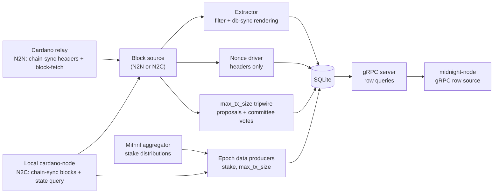

# mc-follower: design

mc-follower replaces cardano-db-sync and PostgreSQL as the Cardano data source of a Midnight node. It follows Cardano, indexes only the data Midnight reads, and serves it to the node over gRPC.

The node side is [midnight-node PR #2498](https://github.com/midnightntwrk/midnight-node/pull/2498), based on midnight-node `node-2.1.101`. The interface is `proto/mc_follower.proto`; [CONTRACT.md](CONTRACT.md) maps each RPC to the SQL it replaces.

## 1. Design summary

| Topic | Design |
|---|---|
| Language | Haskell, built on the Cardano node's own libraries (ouroboros-network, cardano-diffusion, ouroboros-consensus, cardano-ledger, cardano-api). |
| Upstreams | Node-to-node (N2N: public or private relays, no local node) or node-to-client (N2C: a local cardano-node socket). Same indexer core; only the block source differs. |
| N2N trust | The relay is trusted. Headers are not validated. |
| Storage | Embedded SQLite. No PostgreSQL on the node's path. |
| Node interface | gRPC. The node never opens the SQLite file. |
| Where consensus logic lives | In the node (Rust). The indexer returns rows; sorting, batching, cost admission, cursor handling and datum decoding stay in Rust. |
| Node change | Existing data sources become generic over small row-source traits (the db-sync path is unchanged), plus one gRPC row source, one config field (`mc_follower_grpc_endpoint`) and one branch in the backend switch. |
| Epoch nonce | A shipped table of past nonces, nonces supplied at run time, and a nonce driver that computes later ones from headers. |
| Stake distribution | N2C: local node state query. N2N, and epochs outside the node's reach: Mithril stake distributions. |
| `max_tx_size` | N2C: from the node. N2N: a per-network table, plus a tripwire on governance activity that could change it. |
| Genesis CLI commands | Stay on db-sync. Out of scope. |

## 2. Architecture

Components:

1. **Block source.** Yields roll-forward and roll-backward events plus the upstream tip.
   - N2N: initiator-only connection to a relay; chain-sync over headers, range block-fetch for bodies, keep-alive. Pending headers are bounded by backpressure. A failing relay is left for the next one, with backoff.
   - N2C: local chain-sync of full blocks.
   - Both reconnect and re-intersect at recently delivered points.
2. **Extractor.** Pure function from a block to the rows to store, reproducing db-sync's representation (section 4).
3. **Nonce driver.** Runs the consensus library's Praos transitions (`tickChainDepState`, `reupdateChainDepState`) over headers and records the epoch nonce of each epoch. Starts from a trusted protocol state at a Babbage-or-later point (a JSON file holding the node's own CBOR encoding, or the local node's state in N2C). In N2C it is cross-checked against the node's protocol state; a disagreement is recorded in the store and withholds the driver's nonces.
4. **Tripwire.** Records proposals that would change `max_tx_size` and constitutional committee votes, so that a table value that may have been changed on chain is not served until the operator acknowledges the proposal.
5. **Epoch data producers.** Fill in what no block carries: stake distributions (node, Mithril) and the node's `max_tx_size`. Failures are retried with backoff; chain following never waits for them.
6. **Store.** SQLite in WAL mode. One write transaction per block, holding the block's rows and everything the driver and the tripwire derived from it. Rollbacks undo all of it, and are refused beyond the security parameter k.
7. **gRPC server.** Read-only row queries, each answered from one read snapshot.

## 3. What is indexed

The watch set (addresses, policies, metadata label) is a per-network preset compiled into the indexer (`McFollower.WatchSet`), and a database is bound to the watch set it was created with. Requests carry the addresses and policies the node uses; a request naming one the watch set does not index is answered `FAILED_PRECONDITION`, never with an empty result. Changing the watch set needs a new release and a new database; there is no backfill of a newly added address or policy.

| Data | Scope |
|---|---|
| Block index | Every block: hash, number, slot, epoch, time, tx count. Tx hash to (block, index). |
| cNIGHT | Every output carrying the cNIGHT asset at any address, and every spend of such an output. |
| DUST mapping | Every output at the mapping validator address, with its assets and datum, and every spend of one. |
| Governance bodies | Every output at the council and technical-committee addresses, with assets and datum. |
| Permissioned candidates | Every output carrying the permissioned-candidates policy, with datum. |
| Committee candidates | Every output at the committee-candidate address, its datum, spend, and the full input list of its creating transaction. |
| Bridge | Outputs at the ICS and reserve addresses with the bridge token, their spends, and tx metadata under label 6500973. |
| Datums | Every datum db-sync puts in its `datum` table from the start point on (witness datums of valid transactions, inline datums of all outputs it writes). |
| Epoch nonce | One per epoch, the nonce in force during that epoch. |
| Pool stake | Per pool per epoch, equal to db-sync `epoch_stake` summed per pool. |
| `max_tx_size` | Per epoch. |

History: the node verifies historical blocks, so every query must be answerable as of any past stable Cardano block from Midnight's genesis reference on, and the index must contain watched outputs created before that point. The indexer therefore starts from a per-network start point that precedes the first appearance of every watched policy and address. Preview has a preset start point; mainnet and preprod need `--from`.

## 4. Fidelity to db-sync

Importing nodes re-derive Cardano data and compare it bit for bit with the block author's, so rows must equal what db-sync would return. Rules reproduced (from the db-sync 13.8.0.0 source):

- **Addresses:** db-sync's `renderAddress`: bech32 (`addr` / `addr_test`) for Shelley addresses, base58 for Byron.
- **Block time:** slot start time from the era history, whole seconds UTC.
- **Tx count and tx index:** include phase-2-invalid transactions.
- **Phase-2-invalid transactions (Babbage onward):** only the collateral-return output is stored, at index `length(regular outputs)`; the inputs are the collateral inputs; no metadata and no witness datums. In Alonzo, invalid transactions have no outputs.
- **Datums:** an output's datum is resolvable when it is inline, or when a datum with that hash has appeared in the witness set of any valid transaction the indexer has seen (as db-sync's global `datum` table). The original datum bytes are stored.
- **Metadata:** only for valid transactions.
- **EBBs:** no block number; excluded from block-number queries.

Datum and metadata payloads are served as original CBOR bytes. The node decodes them; its gRPC row source produces the same decoded values the db-sync path produces from JSON.

"Not known yet" is never served as "absent". Where the indexer cannot vouch that db-sync would have no row (an epoch nonce or stake distribution it has not obtained, a `max_tx_size` that may have changed, an epoch that is not complete while the indexer is behind its upstream, a bound beyond the indexed tip) it answers `UNAVAILABLE`, which the node treats as a failed data source.

## 5. gRPC contract

Source of truth: `proto/mc_follower.proto`. Principles:

- One RPC per SQL query the node runs on its running path, with the same filters, the same total ordering and the same limit semantics, returning the same columns.
- Requests carry the addresses, policies, block bounds and limits; the server holds no per-node state.
- Queries are answered against the indexer's current chain; the caller bounds them by block number or position exactly as the SQL does.
- Bytes are bytes (hashes, policy ids, asset names, datum CBOR). Text only where the SQL returns text (addresses).
- `GetStatus` exposes the indexer's tip, immutable tip, start block, upstream tip and sync state.
- Errors distinguish "no row" from "indexer cannot answer" (see the proto's error model).

## 6. Node-side change

[midnight-node PR #2498](https://github.com/midnightntwrk/midnight-node/pull/2498):

1. Row-source traits covering exactly the queries each data source makes (`BlockRowSource`, `BridgeRowSource`, `CandidatesRowSource`, `McBlockByHashRowSource`, `CNightObservationRowSource`, `FederatedAuthorityRowSource`). The Postgres code is their first implementation; data-source logic is generic over them, with no behaviour change on the db-sync path.
2. A gRPC row source implementing the same traits against mc-follower (crate `midnight-primitives-mc-follower`).
3. One optional config field, the mc-follower endpoint, and one branch in the backend switch. db-sync remains the default.
4. No changes to the runtime, pallets, inherent data providers or chain specs.

## 7. Verification

- **Offline tests:** the extractor on recorded preview blocks (invalid transactions, hash-referenced datums, Byron addresses, EBBs), the store and rollbacks, every RPC, the nonce driver against recorded protocol states and the shipped table, the tripwire, the block source's backpressure and relay failover.
- **Live checks:** a separate suite against preview (a relay, Koios, the Mithril aggregator), run on request.
- **The node's client:** `test/rust-client` calls every row-source method of the node's gRPC client against a running server, and `compare.py` recomputes the answers from the SQLite database and the shipped nonce table.
- **Nonces:** the driver's nonces are checked against the shipped table (db-sync `epoch_param.nonce`) wherever both have an epoch, and in N2C against the node's protocol state.

## 8. Known limitations

- **No comparison against a running db-sync yet.** The node's client has been checked against the indexer's own database; a parity run of every data-source call against a db-sync-backed node on a public network is still to be done.
- **Mainnet and preprod start points.** Only preview has a preset start point; mainnet and preprod need `--from` until one is chosen.
- **Datums revealed before the start point.** A watched output created after the start point whose datum hash was revealed only in a witness set before it is unresolvable here, while db-sync resolves it. Start points must precede every such datum.
- **Proposals before the start point.** The tripwire matches committee votes to proposals it has seen; a `max_tx_size` proposal submitted before the start point is not seen.
- **Committee votes before protocol version 11.** The ledger then also accepts committee votes from hot credentials that are not currently elected; the tripwire cannot tell them apart and gates on them too.
- **N2C `max_tx_size`.** The node's value is read at its immutable tip, so for the first k blocks of an epoch (and for epochs before the indexer ran with the node) `GetMaxTxSize` answers from the table, guarded by the tripwire as in N2N.
- **Nonce driver off.** Without a trusted state (and without stored checkpoints) the driver does not run: nonces after the shipped table and the supplied ones are answered `UNAVAILABLE` indefinitely, and no nonce gap is checked. A rollback to before the driver's start, when its trusted state is no longer known, turns it off the same way (logged).
- **Consistency across RPCs.** Each RPC reads one snapshot, but a node call that spans several RPCs can see a rollback in between; the proto has no anchor to detect it.
- **N2C** paths (node state queries, the cross-check) have not been run against a node yet.
