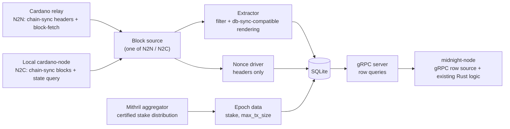

# mc-follower: design spec

mc-follower replaces cardano-db-sync and PostgreSQL as the Cardano data source of a Midnight node. It follows Cardano, indexes only the data Midnight reads, and serves it to the node over gRPC.

Target node version: midnight-node `node-2.1.101`. Node-side work lives in `../midnight-node` on branch `mc-follower-data-source`.

## 1. Decisions already made

| Topic | Decision |
|---|---|
| Language | Haskell, built on the Cardano node's own libraries (ouroboros-network, cardano-diffusion, ouroboros-consensus, cardano-ledger, cardano-api). No pallas. |
| Upstreams | Both node-to-node (N2N, public or private relays, no local node) and node-to-client (N2C, local cardano-node socket). Same indexer core; only the block source differs. |
| N2N trust | The relay is trusted. No header validation. |
| Storage | Embedded SQLite. No PostgreSQL anywhere on the running-node path. |
| Node interface | gRPC. The node never opens the SQLite file. |
| Where consensus logic lives | In the node (Rust). The indexer returns rows; sorting, batching, cost admission, cursor handling and datum decoding stay in Rust. |
| Node change | Minimal and upstreamable: existing data sources become generic over a small row-source trait (behaviour of the db-sync path unchanged), plus one new gRPC row source, one config field and one branch in the backend switch. |
| Stake distribution | N2C: local node state query each epoch. N2N and missed epochs: Mithril certified stake distribution. |
| `max_tx_size` | N2C: from the node. N2N: per-network config value, plus a tripwire on governance proposals that touch it. |
| Genesis CLI commands | Stay on db-sync. Out of scope. |

## 2. Architecture

Components:

1. **Block source.** A single interface yielding `RollForward(block)` and `RollBackward(point)` events plus the upstream tip. Two implementations:
   - N2N: initiator-only client (`Cardano.Network.NodeToNode.connectTo`), chain-sync over headers, range block-fetch for bodies, keep-alive, reconnect with intersect at stored points.
   - N2C: `cardano-api` local chain-sync delivering full blocks.
2. **Extractor.** Pure function from a block to the rows to store. Reproduces db-sync's representation (section 4).
3. **Nonce driver.** Runs the consensus library's protocol state transitions (`tickChainDepState`, `reupdateChainDepState`) on headers to produce the epoch nonce per epoch. Starts from a configured trusted protocol state at a Babbage-or-later point; in N2C mode it cross-checks against the node's protocol state.
4. **Epoch data.** Per-epoch pool stake and `max_tx_size`, from the sources in section 1.
5. **Store.** SQLite in WAL mode. One write transaction per block. Rollback support for the volatile window only (last k blocks).
6. **gRPC server.** Read-only row queries (section 5).

## 3. What is indexed

Watched addresses and policies are not hard-coded: the node passes them in each request (they come from runtime storage and can change by governance). The indexer is configured per network with the set to index and can backfill a newly added address or policy by re-reading history from its upstream.

| Data | Scope |
|---|---|
| Block index | Every block: hash, number, slot, epoch, time, tx count. Tx hash to (block, index). Current tip. |
| cNIGHT | Every output carrying the cNIGHT asset at any address, and every spend of such an output. |
| DUST mapping | Every output at the mapping validator address (with auth-token quantity and datum) and every spend of one. |
| Governance bodies | Every output at the council and technical-committee addresses carrying a token of their policy, with datum. |
| Permissioned candidates | Every output carrying the permissioned-candidates policy, with datum. |
| Committee candidates | Every output at the committee-candidate address, its datum, spend point, and the full input list of its creating transaction. |
| Bridge | Outputs at the ICS and reserve addresses carrying the bridge token, their spends, and tx metadata under label 6500973. |
| Epoch nonce | One per epoch, the nonce in force during that epoch. |
| Pool stake | Per pool per epoch, equal to db-sync `epoch_stake` summed per pool. |
| `max_tx_size` | Per epoch. |

History requirement: the node verifies historical blocks, so every query must be answerable as of any past stable Cardano block from Midnight's genesis reference onward, and the index must contain watched outputs created before that point (cNIGHT since first mint, latest-ever governance outputs). The indexer therefore starts from a configured per-network point that precedes the first appearance of every watched policy and address.

## 4. Fidelity to db-sync

Importing nodes re-derive Cardano data and compare it for equality with the block author's, so rows must equal what db-sync would return. Rules to reproduce (verified against db-sync 13.8.0.0 source):

- **Addresses:** db-sync's `renderAddress`: bech32 (`addr` / `addr_test`, lenient encoding) for Shelley addresses, base58 for Byron.
- **Block time:** slot start time from era history, whole seconds UTC.
- **Tx count and tx index:** include phase-2-invalid transactions.
- **Phase-2-invalid transactions (Babbage onward):** only the collateral-return output is stored, at index `length(regular outputs)`; the inputs are the collateral inputs; no metadata and no witness datums. In Alonzo, invalid transactions have no outputs.
- **Datums:** an output's datum is resolvable when it is inline, or when a datum with that hash has appeared in the witness set of any valid transaction up to the queried point. Store the original datum bytes.
- **Metadata:** only for valid transactions.
- **EBBs:** no block number; excluded from block-number queries.

Datum and metadata payloads are served as original CBOR bytes. The node decodes them; the gRPC row source must produce the same decoded values the db-sync path produces from JSON.

## 5. gRPC contract

Source of truth: `proto/mc_follower.proto`. Principles:

- One RPC per SQL query the node runs today on the running-node path, with the same filters, the same total ordering and the same limit semantics, returning the same columns.
- Requests carry the addresses, policies, block bounds and limits; the server holds no per-node state.
- Queries are answered against the indexer's current chain; the caller bounds them by block number or position exactly as the SQL does.
- Bytes are bytes (hashes, policy ids, asset names, datum CBOR). No hex strings except where the SQL returns text (addresses).
- A `GetTip`/status RPC exposes the indexer's tip and sync state so the node's freshness checks work.
- Errors distinguish "not found" from "indexer unavailable or not yet synced to that point".

## 6. Node-side change

In `../midnight-node`:

1. Introduce row-source traits covering exactly the queries each data source makes. The existing Postgres code becomes the first implementation; data-source logic becomes generic over the trait. No behaviour change on the db-sync path; existing tests must pass unmodified.
2. Add a gRPC row source implementing the same traits against mc-follower.
3. Add one optional config field (the mc-follower endpoint) and one branch in `create_cached_main_chain_follower_data_sources`. db-sync remains the default.
4. No changes to the runtime, pallets, inherent data providers or chain specs.

The change is split into commits that upstream can review independently: (a) refactor only, (b) new backend, (c) wiring and config.

## 7. Verification

- **Parity harness:** for a range of Midnight blocks on a public network, run every data-source call against both a db-sync-backed node build and an mc-follower-backed one and compare results for equality. This is the acceptance test.
- **Nonce check:** computed epoch nonces compared against a local node's protocol state and against db-sync `epoch_param.nonce`.
- **Stake check:** per-pool stake compared against db-sync `epoch_stake` sums.
- Unit tests for the extractor on real blocks covering invalid transactions, hash-referenced datums, Byron addresses and EBBs.

## 8. Open items

- Trusted starting protocol state for the nonce driver per network (source and format).
- Per-network start points and the `max_tx_size` config table.
- Mainnet `max_tx_size` history needs verifying.
- Parity harness needs access to a synced db-sync for at least one public network.
